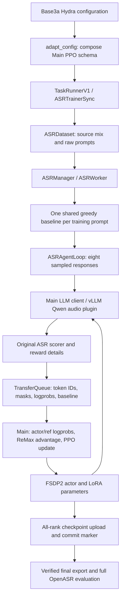

# Base3a Qwen ASR integration into Main: code and execution workflow

This walkthrough describes the Base3a implementation on branch
`boren/main_2611_dev`. All code paths below are relative to the repository
root. It explains the completed experiment and the model integration workflow.

The upstream Main baseline is `662507f9582e16d09c12484387f27727b5d0f947`.
The selected development source is `boren/rl_2611_dev` at
`dffabc00d8261dd9abf3087958259d5c8944f5a2`.
The frozen runtime snapshot is `489bd78dd537d4282c49fe866340eb536c03710f`.
The runtime snapshot identifies the code used by the completed GPU jobs.
The branch additionally contains the permanent report and imported skills;
publication of this branch does not imply a merge into Main.

## Architecture and ownership

The integration uses Main's synchronous V1 trainer, asynchronous LLM request
interface, TransferQueue, FSDP2 engine, policy-loss implementation and online
weight synchronization. It imports the Qwen audio implementation and the ASR
recipe's data/scoring dependencies into two external packages.



`rollout.mode=async` describes concurrent inference requests.
`trainer.v1.trainer_mode=sync` describes the policy update schedule. The
combination waits for the intended rollout batch before updating the policy;
it is not asynchronous policy training. This ASR loop performs one generation
per segment, not a model-driven multi-turn tool episode.

Before adding the report and skills, the implementation diff against Main
had 113 files, 22,241 inserted text lines and 7 removed lines. Most additions are imported model, data, normalizer and config
dependencies. The five ASR adapter modules total 519 lines. Eight existing
production files under `verl/` have 55 insertions and 6 deletions; four new
shared storage/audio modules are additional to those edits. Thus the change is
small at Main's trainer interfaces, while its required dependency footprint is
substantial.

The import manifest covers 58 dependency files: 56 currently match the selected
source SHA-256 exactly. The other two are Qwen package registration files adapted
for CUDA/import ordering. Config imports are recorded separately. The source
trainer's `_compute_reward_metrics` function is reused in the scoring adapter.

## Model package: training and rollout are separate compatibility boundaries

`plugins/qwen35_audio` installs both `hf_qwen35_audio` and
`vllm_qwen35_audio`.

The HF package provides the config, processor, audio feature extractor,
audio encoder/projection and causal language model. Its import registers:

```python
AutoConfig.register("qwen3_5_audio", Qwen3_5AudioConfig, exist_ok=True)
AutoModelForCausalLM.register(Qwen3_5AudioConfig, Qwen3_5AudioForCausalLM, exist_ok=True)
AutoProcessor.register(Qwen3_5AudioConfig, Qwen3_5AudioProcessor, exist_ok=True)
```

`actor_rollout_ref.model.external_lib=hf_qwen35_audio` makes Main import the
package before resolving HF auto classes. The runtime environment also sets
`VERL_USE_EXTERNAL_MODULES=hf_qwen35_audio` for worker processes. This lets
the training path use the installed implementation with the configured
`trust_remote_code=false`, rather than depending on stale Python copies stored
inside each model checkpoint.

The vLLM package is discovered through the `vllm.general_plugins` entry point
named `qwen35_audio`, selected by `VLLM_PLUGINS=qwen35_audio`. Its registration
function associates `Qwen3_5AudioForCausalLM` with the inference implementation.
The plugin prefers a compatible installed vLLM implementation and has a bundled
fallback and version compatibility adapters.

The inference model supplies audio placeholder expansion, multimodal embeddings,
hybrid Qwen backbone state handling, LoRA support and HF-to-vLLM weight-name
mapping. For example, HF `model.layers.*` maps to inference
`language_model.model.layers.*`; `model.embed_tokens_extend.*` maps to
`embed_tokens_extend.*`. Main's existing weight synchronization calls the
backend's loader, so this mapping is needed during online updates as well as
initial loading. No new whole-model weight synchronization implementation was
introduced.

The source plugin's LoRA compatibility filters and hybrid-state adaptations
are reused. They should not be copied blindly to a different architecture.

## Recipe package and configuration translation

`plugins/phimm` is an editable namespace package exposing `recipe.phimm`.
This preserves existing source import paths and Hydra config names without
replacing Main's `recipe` submodule.

Its imports include the selected Base3a config inheritance chain, six training
sources, validation/full-evaluation manifests, audio/chunk loading, prompt
construction, reward functions and multilingual text normalizers. It does not
import the legacy DAPO training loop or synchronous vLLM rollout engine.

`main_asr_remax.py` resolves the source Hydra config, calls `adapt_config`,
sets worker environments, saves an effective config and invokes Main's
`run_ppo(..., task_runner_class=TaskRunnerV1)`. It requires a unique experiment
name to avoid writing into the original Base3a output root.

`agentic/config.py` first composes Main's `ppo_trainer`. It copies supported
source fields into that schema, keeps Main's `_target_` classes, retains
ASR-owned data/reward declarations and records omitted legacy keys in
`asr.source_only_keys`. Recording omissions is not proof that they are harmless;
the effective settings and behavior still have to be checked.

It then configures the extension points:

```yaml
actor_rollout_ref:
  model:
    external_lib: hf_qwen35_audio
  rollout:
    mode: async
    agent:
      default_agent_loop: asr
      agent_loop_manager_class: recipe.phimm.agentic.agent_loop.ASRManager
trainer:
  v1:
    trainer_mode: sync
    trainer_class: recipe.phimm.agentic.trainer.ASRTrainerSync
  checkpoint_callback_class: recipe.phimm.agentic.trainer.ASRCheckpointCallback
```

The imported experiment keeps batch128, eight samples per prompt, LoRA
rank320/alpha640, LR6e-7, two epochs, validation every20 and save every10,
with a two-node/eight-GPU-per-node setup.

Its six source budgets are 20,424 noisy LS, 9,568 earnings, 3,125 Quartr first23,
6,392 Quartr second48, 6,155 Quartr third38 and 10,000 AISHELL: 55,664 rows.
The target is `floor(55664 / 128) * 2 = 868` optimizer updates. Runtime checks
reject changes to the dataset size or resulting update count. The 112-row
remainder per epoch does not become an extra optimizer batch.

Several implicit source behaviors required explicit translation:

| Behavior | Setting preserved by the adapter |
|---|---|
| Inference seed | 0 on each replica, rather than inheriting Main's42 |
| Generated token logprobs | Raw logprobs, rather than Main's processed defaults |
| Generation limits | 768 sampled training tokens;512 greedy/validation tokens |
| Repetition suppression | ngram15, preserving the source's actual processor argument spelling |
| Effective repetition window |100: the source passes `ngram_window`, while the processor reads `window_size` |
| Greedy/validation repetition | Retains the source's inherited training extra arguments |
| Importance correction | Per-token, capped at5, with batch normalization disabled |
| Model execution | Source compile/packing choices and source-compatible vLLM options |

Changing the repetition argument spelling to obtain512 would change the
experiment. Matching effective behavior matters more than copying YAML labels.

## Dataset, generation and token identity

`agentic/dataset.py` subclasses the imported ASR `RLHFDataset`. Each training
item contains `raw_prompt`, `asr_segments`, `asr_validate=false` and
`agent_name=asr`. Training requires exactly one segment per trajectory.

`ASRAgentLoop.generate_row` loads the audio, applies the original chat template
and optional prefix, and runs the HF processor. There are deliberately two
prompt representations:

1. Inference receives the text token IDs containing the audio placeholder plus
   the waveform. vLLM expands that placeholder itself.
2. The training trajectory stores the HF processor's expanded prompt IDs.

Sending HF-expanded placeholders into a backend that expands them again would
break alignment. Preflight compares the resulting vLLM-expanded prompt IDs
against the HF prompt IDs on a real example from each of the six sources.

Training responses retain vLLM's exact generated token IDs and token logprobs.
They are not decoded and retokenized to construct training targets. The
response mask marks generated tokens; TransferQueue maps it to the loss mask.
`ASRWorker._compute_multi_modal_inputs` reconstructs processor audio tensors
for the actor's forward pass, while the actual response IDs remain unchanged.

Main's collation needed two audio-specific cases: pad
`input_audio_embeds` along its time axis, then make the restored
`(audio,time,mel)` tensor contiguous; and pad `audio_attention_mask` along
time. The contiguity requirement fixes an actual source frontend `.view()`
failure exposed by ragged batching. The source HF frontend itself remains
unchanged. A regression test compares the actual `LightPatchEncoder` output
with an independently padded contiguous batch.

The processor dispatch also recognizes `Qwen3_5AudioProcessor` as using normal
one-dimensional training positions, without binding a vision-specific RoPE
helper.

## ReMax baseline, reward and optimizer update

`ASRWorker._run_prompt` generates one greedy transcript before Main starts the
eight sampled sessions. It attaches `greedy_hyp`, the full `greedy_reward`
measurement dictionary and a scalar `reward_baselines` to the prompt, so all
eight samples share the same baseline. Baseline failure publishes a failed
TransferQueue prompt status before propagating the error.

`score_response` dispatches by `data_source` using the original configured
ASR scorer. For this vote scorer, an unseeded greedy call intentionally returns
score0 plus raw measurements. Sampled responses compare their measurements
against those greedy measurements, then apply the configured deltas/absolute
votes, clipping, weights and reduction. The greedy score0 therefore does not
mean that the greedy hypothesis has zero error or zero utility.

Main already implements ReMax. The generic V1 change adds `reward_baselines`
to the fields retrieved from TransferQueue when ReMax is selected. The
existing estimator computes masked returns minus that scalar baseline:

```text
A(j,t) = return(j,t) - baseline(j) * response_mask(j,t)
```

The scalar baseline and component-wise greedy measurements are different
contracts. Replacing the reward with plain negative WER, or subtracting the
greedy error a second time, would change this experiment.

Main's normal PPO update computes actor old logprobs, reference logprobs,
advantages and actor gradients. The adapter configures token importance
weights `min(exp(old_actor_logprob - rollout_logprob), 5)` without batch
normalization. A focused test compares Main's loss and its gradients with the
source single-on-policy-minibatch objective under `seq-mean-token-sum`.
That test does not establish equivalence for arbitrary multi-update schedules.
The original KL-loss configuration is also retained.

`ASRTrainerSync` inherits the normal optimizer/update/weight-sync loop. Its
overrides handle ASR metrics, dataset-size guards, durable resume and evaluation
artifacts. Reward logging excludes TransferQueue padding entries and iterates
the actual TensorDict list representation; it does not assume `.tolist()`.

## Validation and full OpenASR evaluation

Validation groups rows by `(data_source,parent_audio)` and sorts segments by
start time before generation and scoring. Generated segment text is joined
before it is compared with the parent reference. This avoids comparing each
segment against an entire long recording. Joined validation text may be
retokenized for evaluation output, but it never enters an optimizer update.

Corpus WER/CER is `sum(n_err) / sum(n_ref)`, not mean utterance error rate.
The trainer writes both aggregate and per-dataset JSONL and metric JSON files
to the experiment's local and Blob result locations.

Full evaluation uses `main_asr_eval.py` and the same adapter. Its entry point
requires validation-only execution and an already merged model with LoRA rank0.
The selected manifest has35 sources, including the two French long sources
present in the historical reference. Chinese uses CER; other reported sources
use WER. The33 canonical datasets and13 means remain separate from the French
supplement in presentation, while all35 participate in the acceptance gate.

The final export gathers every required FSDP model shard, derives LoRA
rank/alpha from the producer configuration and checkpoint metadata, merges176
adapter pairs and checks781 finite tensors against expected keys/shapes. It
also verifies safetensors readability and processor/tokenizer assets before
uploading the evaluation model. A filename or file count alone is insufficient.

## Storage, checkpoint publication and recovery

The shared `verl.audio_cache`, `audio_chunk` and `audio_zip` modules are reused
from the source. `verl.utils.azure_io` adds Azure handling to the existing
`copy_to_local` boundary. Per-node file locking, staging and atomic rename
avoid exposing half-downloaded model directories to sibling ranks. Cache
identity includes an experiment namespace and assumes immutable source content.

With node-local storage, rank0 cannot see the other node's shards. Each FSDP
rank therefore uploads its own model/optimizer/extra-state files for Azure
checkpoints, followed by a distributed barrier. Rank0 uploads HF/LoRA metadata.
The recipe callback uploads the stateful loader's `data.pt` and publishes
`latest_checkpointed_iteration.txt` last. The remote marker identifies the
committed step; upload errors propagate instead of being hidden.

Auto-resume selects the committed Azure step, loads actor shards and restores
the stateful dataloader. This adapter does not support a critic. Per-rank local
checkpoint retention also runs on nonzero nodes for Azure-backed saves.

Checkpoint868 had CPU verification of all16 ranks' Adam counters, scheduler
step, RNG presence, finite LoRA tensors and loader position. This is stronger
than a shard count, but an independent live distributed reload of868 was not
performed. The training exit-finalizer warning and raw audit remain retained.

## The small changes to existing Main files

| Existing file | Change | Reason |
|---|---|---|
| `verl/trainer/config/ppo_trainer.yaml` | Optional `trainer.v1.trainer_class`, default null | Select a recipe trainer subclass |
| `verl/trainer/main_ppo.py` | Resolve that class, otherwise use normal mode registry | Keep custom behavior outside Main's trainer |
| `verl/trainer/ppo/v1/agent_loop_tq.py` | Expose undecorated `AgentLoopWorkerTQBase`; keep existing Ray actor alias | Allow normal Python subclassing before Ray wrapping |
| `verl/trainer/ppo/v1/trainer_base.py` | Fetch `reward_baselines` for ReMax | Connect existing estimator to queue data |
| `verl/utils/model.py` | Pad audio features/masks correctly; contiguous feature output | Support variable-duration actor batches |
| `verl/utils/tokenizer/tokenizer.py` | Recognize the audio processor's position convention | Avoid vision-specific processor assumptions |
| `verl/utils/fs.py` | Dispatch Azure paths to the Azure helper | Reuse the standard loading boundary |
| `verl/utils/checkpoint/fsdp_checkpoint_manager.py` | Per-rank Azure publication, barrier and retention | Make multi-node checkpoints durable |

The trainer override defaults to null, the original Ray actor name remains
available and the new storage branch is conditional on `az://`.

## Workflow for integrating another model into Main

1. **Check both model backends.** If the installed Transformers and chosen
   rollout engine already support the architecture, start with a model-path
   change. FSDP's model path does not use Megatron's model registry. See
   `docs/advance/fsdp_extension.rst` and `verl/models/README.md`.
2. **Package only missing model support.** Register HF config/model/processor
   in an importable package and set `model.external_lib`. Add an inference
   plugin only if the backend lacks support. Install the same package and
   dependencies on every relevant Ray node and spawned process.
3. **Prove the processor contract.** Compare expanded prompt token IDs,
   feature lengths/masks, positions, generated IDs and aligned logprobs.
   Exercise ragged and packed inputs as well as a simple padded example.
4. **Verify weight synchronization.** Check parameter names, packed projections,
   hybrid state and LoRA target mappings. Reuse Main's named-tensor transfer.
   Run at least two optimizer steps so reload after the initial inference
   post-processing is exercised; compare actor/rollout logprobs as appropriate.
5. **Choose the smallest task extension.** A model does not inherently need a
   new agent or trainer. Use a built-in single-turn/tool loop where its contract
   fits. Use a custom `AgentLoopBase.run` for task-specific behavior, retaining
   generated IDs and masks. Add a custom manager/worker only for shared prompt
   work such as this greedy baseline. Add a trainer subclass only for metrics,
   persistence or other behavior not represented by existing hooks.
6. **Compose Main's schema and audit defaults.** Record effective configs,
   omitted keys, data order/budgets, sampling, logprob mode, loss reduction,
   correction, KL and resume behavior. Pin actual behavior rather than relying
   on inherited YAML defaults.
7. **Validate in increasing cost.** Import/processor checks, task/scorer tests,
   real forward/backward, small online updates, checkpoint save/reload, then
   a full training run and exact-final-checkpoint evaluation. Preserve earlier
   attempts and all comparable dataset results.

For this installed two-node environment, the entry points are:

```bash
uv pip install --system --no-deps -e . -e plugins/phimm -e plugins/qwen35_audio
python -m pytest -q plugins/phimm/tests/test_adapter.py
python -m recipe.phimm.preflight trainer.experiment_name=<unique-name>
python plugins/phimm/submit.py --submission-id <unique-training-id> \
  trainer.experiment_name=<unique-name>
# After separately exporting and verifying the chosen checkpoint:
python plugins/phimm/submit.py --evaluate --submission-id <unique-evaluation-id> \
  trainer.experiment_name=<unique-evaluation-name> \
  actor_rollout_ref.model.path=<verified-merged-HF-path>
```

These commands assume an already provisioned/synced Ray pool and compatible
dependencies. The repository's recipe README lists pinned scorer dependencies.
The submission helper contains environment-specific CUDA library paths; it is
an example for this environment, not a portable scheduler for all clusters.

## What was verified, and what remains uncertain

Recorded checks include9 adapter tests,12 Main TQ/checkpoint/trainer checks,
8 model/audio contract checks, spawned CUDA registration on both nodes, real
processor equivalence on all six source probes and a real-audio GPU
forward/backward probe. They are historical experiment evidence; no new GPU
test is run by this walkthrough.

Training completed868/868. Final validation passed4/9 dataset gates; fresh
full OpenASR260 passed31/35, and final full868 passed29/35 under the user's
unchanged +0.1 percentage-point maximum regression. All three new evaluations
completed35 sources and192,883 raw segments. The two comparisons' raw cohorts
and text scoring code match; some hypothesis-dependent normalized denominators
legitimately differ and are retained independently.

The original training used legacy rewards through120 and resumed with newer
code/scoring thereafter. The candidate used the requested source scorer from0.
This confounds attribution of quality differences; uniform validation scoring
cannot remove training-history differences. The integration executed the full
pipeline, but the strict quality reproduction objective remains unmet.
No regression cause has been established.

All three dedicated pools were verified paused after artifact collection, with
all six case pods absent. The report regeneration and this walkthrough run
locally and do not restart training or evaluation.

## Report and source provenance

See [the experiment report](report.md), [the 15-page PDF](report.pdf),
[dependency import manifest](provenance/import_manifest.json), and
[packaging and verification notes](README.md). The skill import uses a newer
source revision than the frozen training implementation; their provenance is
recorded separately in `../../../.github/skills-import.json`.
