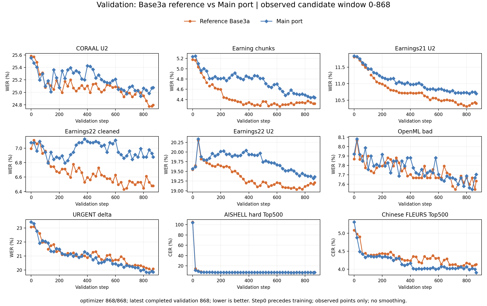
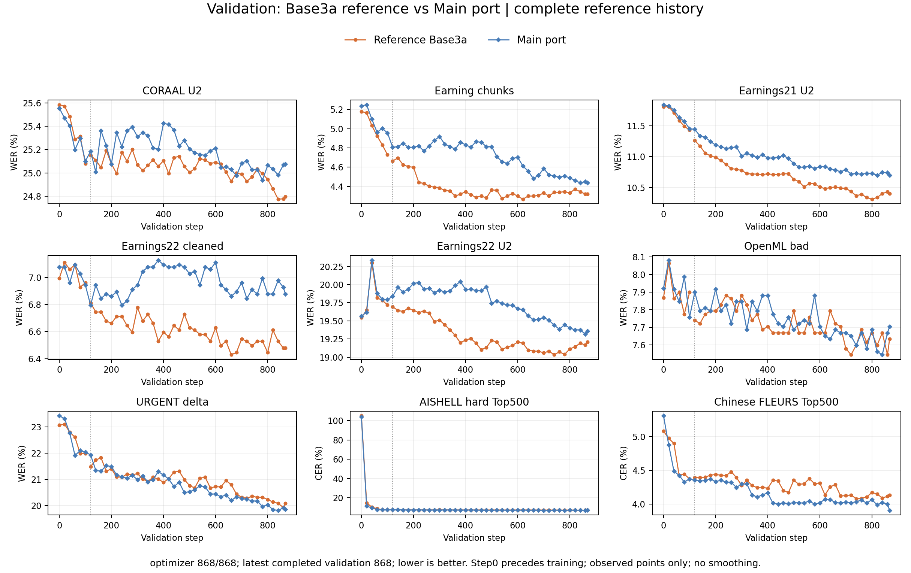
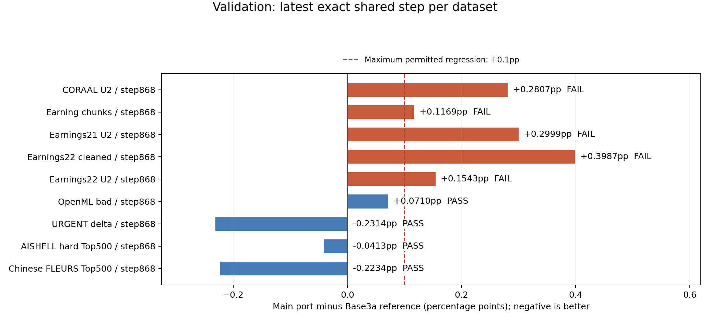
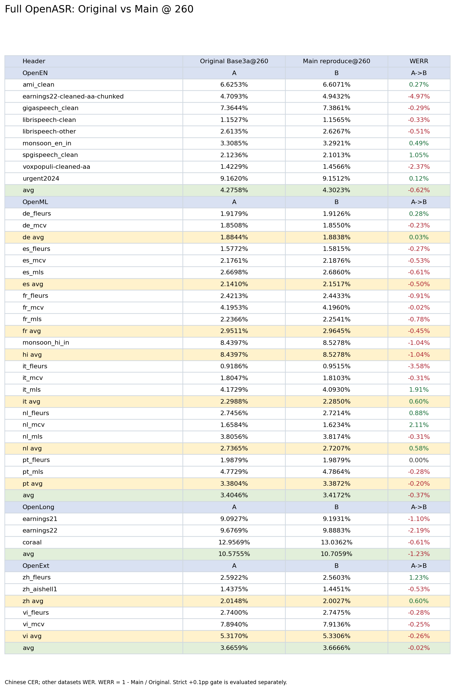
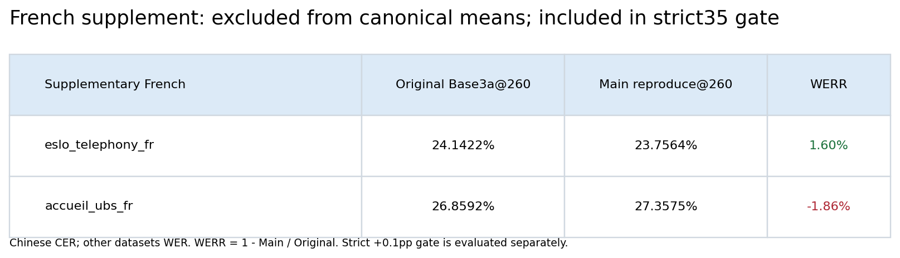
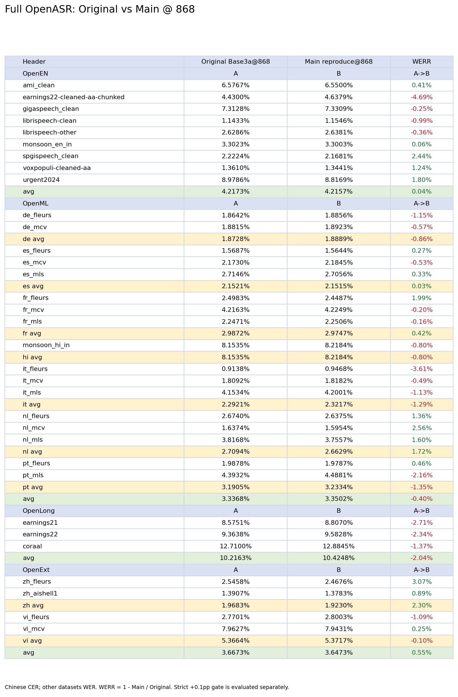
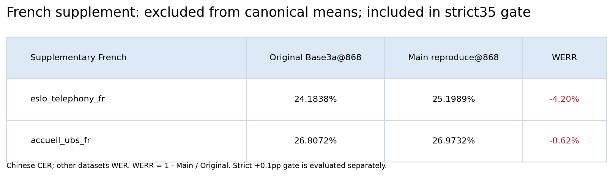
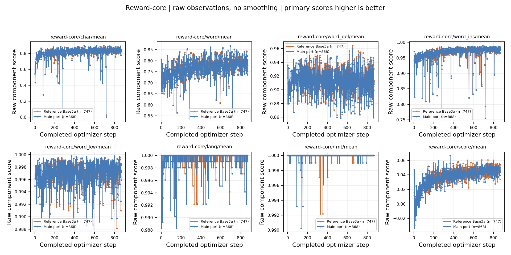

# Base3a on main: training comparison

Collected: 2026-11-13T19:08:30.341406+00:00

optimizer 868/868; SUCCEEDED. Training868, final validation/checkpoint/export868 and all three full35 evaluations complete. Validation868 and full35 regression gates are assessed separately; completed execution does not imply parity.

Shutdown warning: an exit-finalizer DataLoader worker-kill traceback follows final868 metrics/validation and W&B sync. Ray driver exit0; worker-kill cause unresolved. Raw trace/audit and independent checkpoint CPU/loader proofs retained.

Final Validation868: **4/9 pass**; **Full35@260: 31/35 pass**; **Full35@868: 29/35 pass**. **Reproduction does not meet the agreed quality gates.**

## Configuration differences

| Setting | Reference | Main |
|---|---|---|
| Producer revision | e99efbb through120; resumed965a025 | Main662507f9 + required imports; 489bd78dd5 |
| Trainer / rollout | Legacy DAPO / synchronous vLLM | V1 sync / AgentLoop + TransferQueue |
| data.chunk_load_mode | sample | indexed |
| Historical training scorer | Legacy through120, current thereafter | Requested dffabc scorer from0 |

## Validation

Completed candidate validation steps: [0, 20, 40, 60, 80, 100, 120, 140, 160, 180, 200, 220, 240, 260, 280, 300, 320, 340, 360, 380, 400, 420, 440, 460, 480, 500, 520, 540, 560, 580, 600, 620, 640, 660, 680, 700, 720, 740, 760, 780, 800, 820, 840, 860, 868].

| Dataset | Step | Reference % | Main % | Delta pp | Gate |
|---|---:|---:|---:|---:|---|
| coraal_u2 | 868 | 24.7967 | 25.0774 | +0.2807 | FAIL |
| earning_chunk_verb | 868 | 4.3196 | 4.4365 | +0.1169 | FAIL |
| earnings21_u2 | 868 | 10.4010 | 10.7009 | +0.2999 | FAIL |
| earnings22_cleaned_aa_u2 | 868 | 6.4784 | 6.8771 | +0.3987 | FAIL |
| earnings22_u2 | 868 | 19.2068 | 19.3611 | +0.1543 | FAIL |
| openml_bad | 868 | 7.6322 | 7.7032 | +0.0710 | PASS |
| urgent2024_delta | 868 | 20.0819 | 19.8505 | -0.2314 | PASS |
| zh_aishell1_top500_2611r2 | 868 | 7.1478 | 7.1065 | -0.0413 | PASS |
| zh_fleurs_top500_2611r2 | 868 | 4.1286 | 3.9051 | -0.2234 | PASS |

Gate history: step0: 7/9 pass; step20: 8/9 pass; step40: 9/9 pass; step60: 9/9 pass; step80: 6/9 pass; step100: 8/9 pass; step120: 4/9 pass; step140: 4/9 pass; step160: 5/9 pass; step180: 4/9 pass; step200: 4/9 pass; step220: 4/9 pass; step240: 6/9 pass; step260: 4/9 pass; step280: 4/9 pass; step300: 4/9 pass; step320: 3/9 pass; step340: 3/9 pass; step360: 4/9 pass; step380: 2/9 pass; step400: 2/9 pass; step420: 3/9 pass; step440: 4/9 pass; step460: 5/9 pass; step480: 4/9 pass; step500: 4/9 pass; step520: 4/9 pass; step540: 5/9 pass; step560: 5/9 pass; step580: 3/9 pass; step600: 4/9 pass; step620: 5/9 pass; step640: 5/9 pass; step660: 4/9 pass; step680: 5/9 pass; step700: 5/9 pass; step720: 3/9 pass; step740: 5/9 pass; step760: 5/9 pass; step780: 5/9 pass; step800: 4/9 pass; step820: 5/9 pass; step840: 5/9 pass; step860: 3/9 pass; step868: 4/9 pass. Training868, final validation/checkpoint/export868 and all three full35 evaluations complete. Validation868 and full35 regression gates are assessed separately; completed execution does not imply parity.

## Full OpenASR at step260

Strict +0.1pp gate: **31/35 pass**. Matched raw cohorts and text scoring code verified. Normalized corpus denominators are retained independently; exact counts and flags are in the comparison evidence.

[Excel comparison](full_eval_s260/comparison.xlsx)

Failed datasets: earnings22-cleaned-aa-chunked +0.233842157pp; accueil_ubs_fr +0.498338870pp; earnings21 +0.100411939pp; earnings22 +0.211464037pp.

## Full OpenASR at step868

Strict +0.1pp gate: **29/35 pass**. Matched raw cohorts and text scoring code verified. Normalized corpus denominators are retained independently; exact counts and flags are in the comparison evidence.

[Excel comparison](full_eval_s868/comparison.xlsx)

Failed datasets: earnings22-cleaned-aa-chunked +0.207859695pp; eslo_telephony_fr +1.015077763pp; accueil_ubs_fr +0.166028097pp; earnings21 +0.231976613pp; earnings22 +0.218994518pp; coraal +0.174488125pp.

## Reward-core

Reference legacy rewards excluded from numeric comparisons; full histories retained.

| Component | Exact window | n | Reference mean | Main mean | Delta |
|---|---|---:|---:|---:|---:|
| reward-core/char/mean | [121, 867] | 747 | 0.819584 | 0.819074 | -0.000509765 |
| reward-core/fmt/mean | [121, 867] | 747 | 0.999962 | 0.999948 | -1.43804e-05 |
| reward-core/lang/mean | [121, 867] | 747 | 0.999731 | 0.999691 | -3.92194e-05 |
| reward-core/score/mean | [121, 867] | 747 | 0.041278 | 0.0407076 | -0.000570397 |
| reward-core/word/mean | [121, 867] | 747 | 0.774587 | 0.772519 | -0.002068 |
| reward-core/word_del/mean | [121, 867] | 747 | 0.91439 | 0.911408 | -0.00298197 |
| reward-core/word_ins/mean | [121, 867] | 747 | 0.969052 | 0.969536 | +0.000483136 |
| reward-core/word_kw/mean | [121, 867] | 747 | 0.997141 | 0.997132 | -8.96943e-06 |

Arithmetic means at exact common observed optimizer steps; primary scores higher is better. These are batch diagnostics, not validation or a causal comparison.

## Provenance and limits

- Historical completed reference used legacy scorer through checkpoint120, then resumed at965a025. Candidate follows requested dffabc scorer from zero; uniformly rescored validation permits metric comparison, but cannot undo historical reward differences.
- All step0 retries retained separately; no cherry-picking. Strict tolerance remains0.1pp per dataset.
- Training868, final validation/checkpoint/export868 and all three full35 evaluations complete. Validation868 and full35 regression gates are assessed separately; completed execution does not imply parity.

## Regenerated deliverables and code walkthrough

Rebuilt from the saved evidence; no training or inference rerun.

[Detailed code changes and model integration workflow](CODE_WORKFLOW.md).

All three dedicated resource pools were verified paused; all six case pods absent. The strict quality gate remains failed.
