## Replay changes sampling and reward scale

Pinned source audit and collected W&B configs; live stop verified by exact Ray submission.

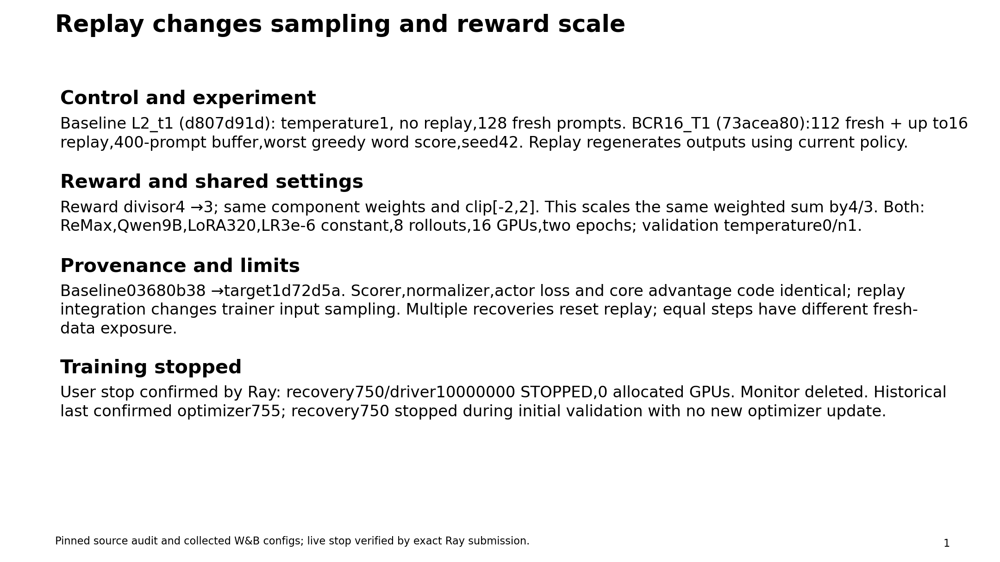

## Validation trajectories — preserve dataset tradeoffs

Observed points only; lines are guides. Target latest740 vs baseline600 is an unequal-budget comparison. Initial/latest/best shown separately.

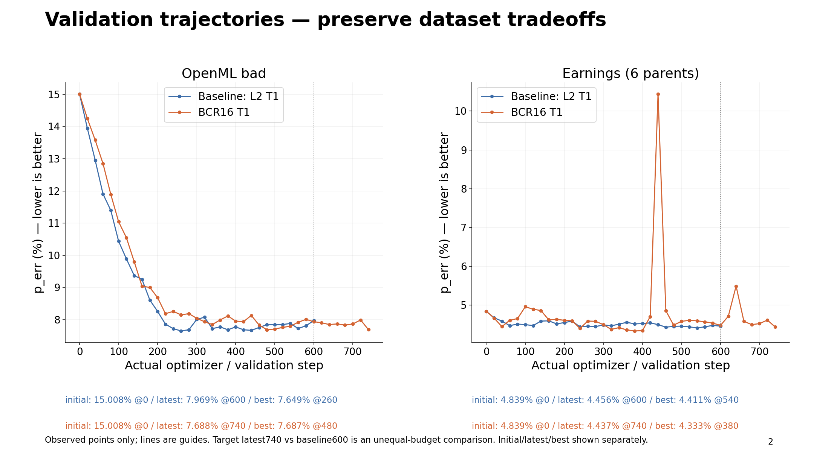

## Validation trajectories — preserve dataset tradeoffs

Observed points only; lines are guides. Target latest740 vs baseline600 is an unequal-budget comparison. Initial/latest/best shown separately.

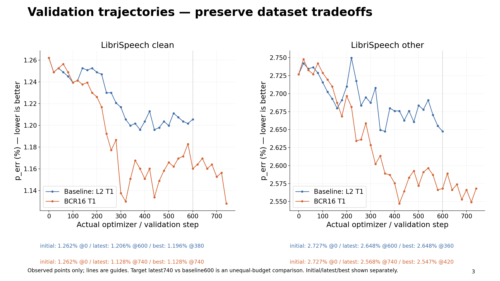

## At step600: LS gains; Earnings slightly regresses

Exact shared step600. No cross-dataset averaging; single-run descriptive comparison with reward-scale and exposure confounds.

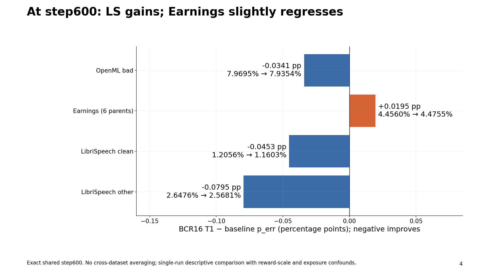

## reward-core: raw batch means through step600

No smoothing/interpolation. Logged history includes abandoned pre-recovery updates; all22 keys retained. Batches differ by replay.

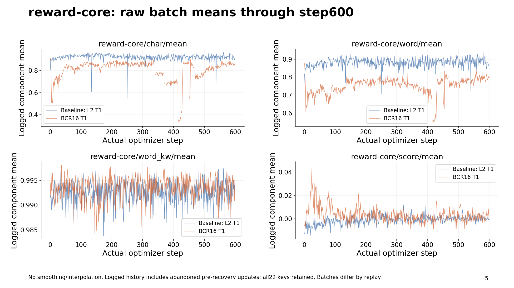

## reward-core: exact shared window591–600

10 observations per run per component; arithmetic means. Core score has a different divisor and is not a like-for-like quality metric.

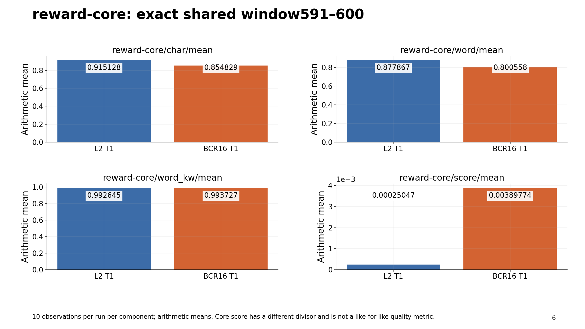

## reward-delta: raw batch means through step600

No smoothing/interpolation. Logged history includes abandoned pre-recovery updates; all22 keys retained. Batches differ by replay.

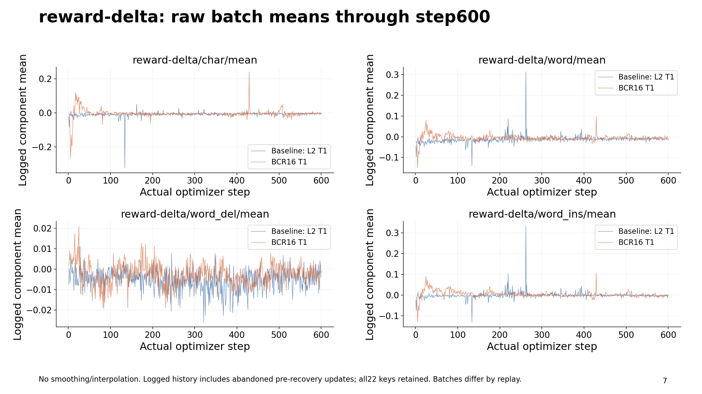

## reward-delta: exact shared window591–600

10 observations per run per component; arithmetic means. Core score has a different divisor and is not a like-for-like quality metric.

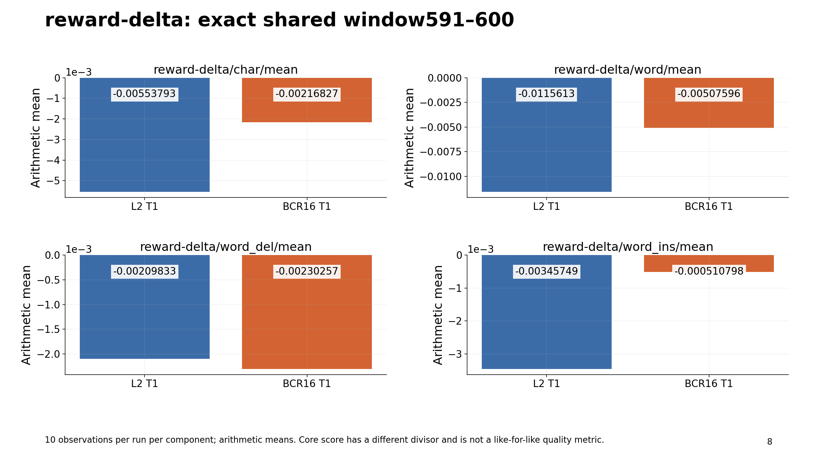

## reward-vote: raw batch means through step600

No smoothing/interpolation. Logged history includes abandoned pre-recovery updates; all22 keys retained. Batches differ by replay.

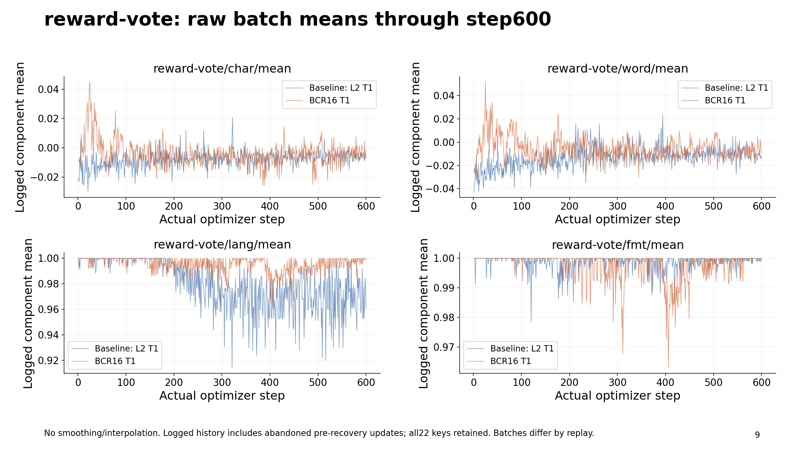

## reward-vote: exact shared window591–600

10 observations per run per component; arithmetic means. Core score has a different divisor and is not a like-for-like quality metric.

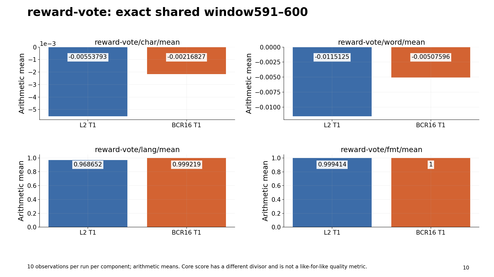

## Matched examples quantify improvements and regressions

Step600 full dumps; unchanged stable IDs and references. Earnings grouped341 chunks into6 parents; OpenML393,LS clean2620,LS other2939.

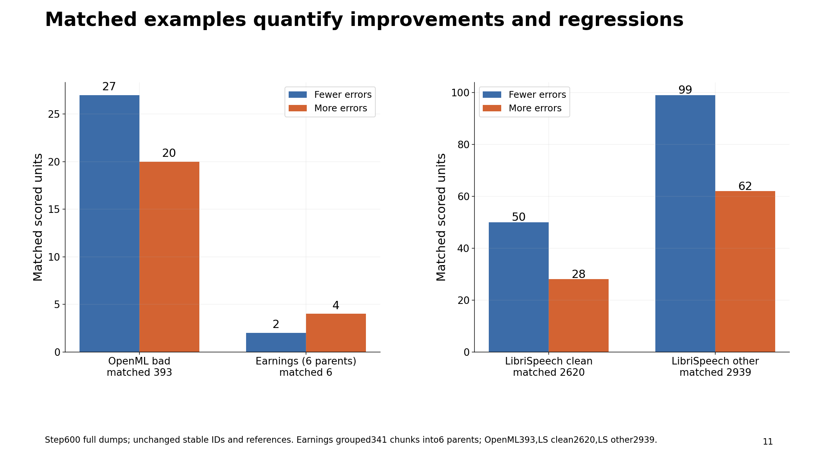

## Stable-ID cases: content and scoring-sensitive forms

Excerpts are illustrative; complete outputs, references and logged error counts retained in evidence.json. No acoustic cause inferred.

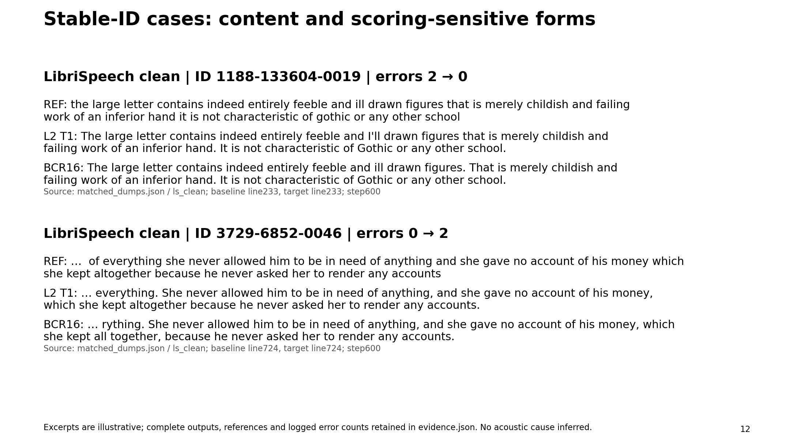

## Stable-ID cases: content and scoring-sensitive forms

Excerpts are illustrative; complete outputs, references and logged error counts retained in evidence.json. No acoustic cause inferred.

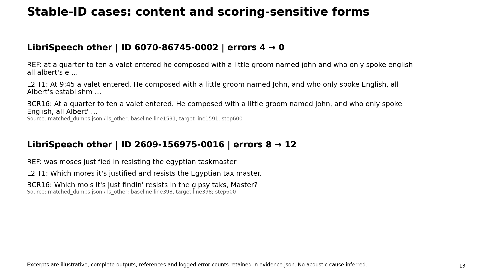

## Stable-ID cases: content and scoring-sensitive forms

Excerpts are illustrative; complete outputs, references and logged error counts retained in evidence.json. No acoustic cause inferred.

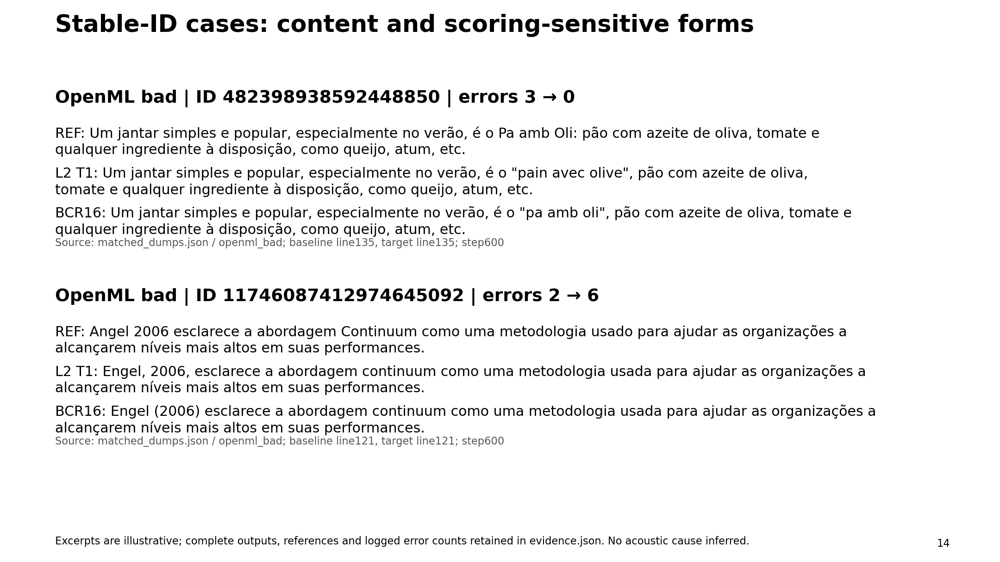

## Earnings: six parents, small net change hides mixed effects

Pinned source audit and collected W&B configs; live stop verified by exact Ray submission.

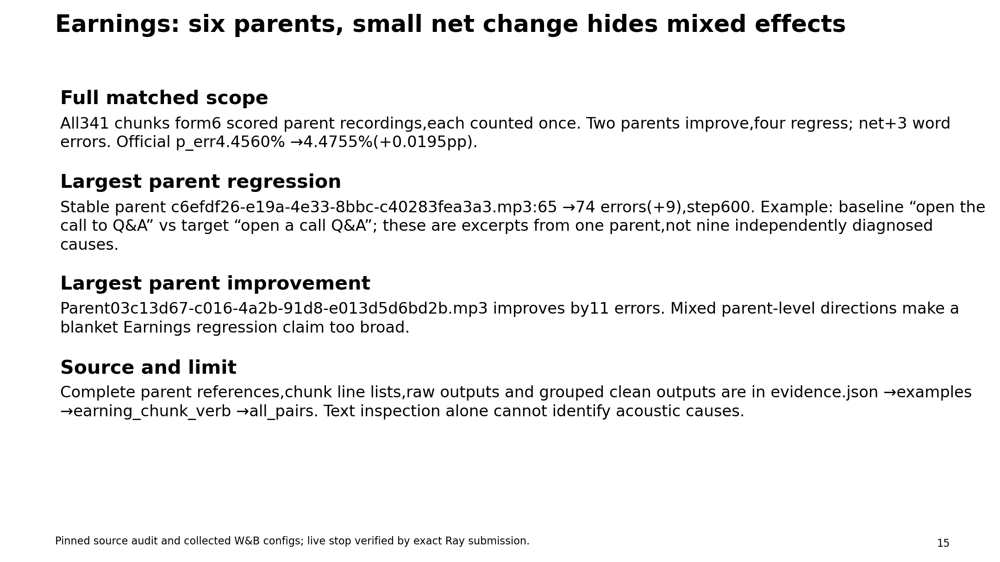

## Check scoring-sensitive changes before tuning rewards

Pinned source audit and collected W&B configs; live stop verified by exact Ray submission.

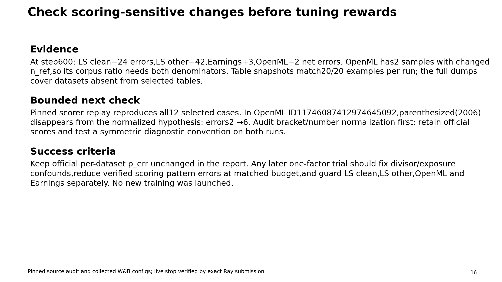
