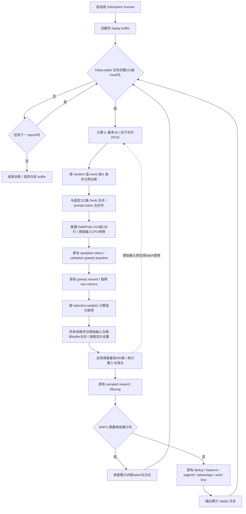

# Bad case replay 实施方案

## 目标与范围

在 ReMax 的每个 generation batch 得到 greedy baseline reward 后，按可配置指标保存低分原始输入。下次将这些输入与 DataLoader 的 fresh 输入组成普通 DataProto，重新执行原有 rollout、baseline generation、reward 和训练流程。

实现覆盖公共 RayPPOTrainer 和 Phimm 使用的 RayDAPOTrainer，默认关闭。Replay 只影响原始输入抽样、buffer 更新及日志；合并后保留原有 generation、validation baseline 解码、reward、filter/dedup、balance、logprob、advantage 和 actor loss。

## 已确认的配置与行为

### 1. 固定 fresh 与 replay 数量

- B 是 rollout.n 扩展前的名义 generation prompt batch size，取 data.gen_batch_size，未配置则取 data.train_batch_size。
- `replay_size` 是预留的整数回放数量，默认16，替代原先的比例配置。固定 fresh 数量 F=B-replay_size。
- 当前实验 B=128、DP=16、replay_size=16，所以 DataLoader 每次固定取112条，保留 drop_last=True。
- B 和 replay_size 都必须能被 DP 整除，且 0<=replay_size<B；DP 使用配置的 nnodes*n_gpus_per_node，满足现有 actor/rollout worker 分发约束。
- 实际抽取 k=floor(min(replay_size,buffer_size)/DP)*DP 条。未够一个 DP 整数倍的条目继续留在 buffer。
- 实际 batch 行数 N=F+k，因此同样能被 DP 整除。buffer 为空时当前实验 N=112，buffer 充足时 N=128。
- 不增加 fresh 数量补足回放空缺，不复制训练行、不增加 replay mask 或 replay loss。token padding 和 batch 行数整除分别在输入构造阶段处理。
- DataLoader 耗尽即结束 epoch，不生成 buffer-only batch。data.train_batch_size 继续作为原有 DAPO filtering 训练目标。
- 总训练步数继续按原有 DataLoader 长度推导；fresh 从116改为112会改变未来新启动的 horizon，须以实际启动日志为准，不硬编码100步。

### 2. 采样与出库

- `sampling: random` 使用独立有种子的 RNG，均匀无放回抽样。
- `sampling: worst` 按保存的 selection_score 从低到高抽取，相同分数维持稳定顺序。
- 两种策略都使用上述 DP 对齐后的 k，抽到的条目立即出库。
- 已抽取样本在本批得到有限评分后参与全局容量排序，只有通过最终保留后才再次入库。

### 3. 指标与全局保留

- 不对当前 generation batch 进行单独的低分预筛选，也不限制每批入库候选数。
- 当前所有有限评分的原始 prompt 均参与更新，与剩余 buffer 按稳定 ID 去重后，仅在全局按低分优先保留最多400条。
- 候选数等于当前有限评分的原始 prompt 数；rollout.n 扩展行不重复计数。
- 每个原始 prompt 使用本次 greedy baseline reward 返回的标量指标。selection.weights 支持单指标或加权组合，权重与训练 reward 权重独立。
- selection_score=sum(weight*raw_metric)/sum(weight)；权重必须有限、非负且总和大于零，零权重指标不需要存在。
- 所有指标保留原始数值，包括负 error。始终低分优先，不转换 accuracy、不反转符号。
- 配置的非零权重指标缺失或形状错误时明确报错；NaN/Inf 样本跳过并计数。
- asr_vote 的 greedy 总 score 可能恒为0，实验仅选择 word=1，不配置未使用的 char 指标。
- 仅在 ReMax 下启用，以获得逐 prompt 的 greedy baseline 指标。

### 4. Buffer 内容、更新与容量

- capacity=400，仅保存原始输入及稳定身份、最近指标和 selection_score。
- 在混合输入构造后、任何随机 uid、pop、repeat、generation union、filter/dedup/balance 前制作独立 CPU 深拷贝快照。
- 不保存 responses、reward、logprob、advantage 等生成字段，也不使用随机训练 uid 去重。
- tensor detach/cpu/clone；嵌套字典、object ndarray、音频和 meta_info 同样深拷贝，避免与训练批次互相修改。
- 使用数据来源、原始 id/audio/segment 信息建立稳定身份；缺少可靠标识时使用去除 batch-dependent padding 的原始输入指纹。
- fresh/replay 合并时为已有 prompt 序列字段统一左补齐宽度，保留 audio、metadata 和普通 DataProto 表示。其他 tensor 形状不兼容则报错。
- 每个 generation batch 得到 greedy reward 后，先更新 buffer，再进入原有 DAPO filtering；continue 不丢失更新或日志。
- 将剩余 buffer 与本批所有有限评分的原始输入合并，按稳定 ID 去重，重复 ID 使用本批最新有效评分。
- 已出库 replay 也参与同样的全局容量排序；无效评分不参与候选，也不会自动回库。
- 全局按分数升序保留最多400个不同样本，淘汰较高分；未再次观察的条目保留上次评分。

### 5. 生命周期与日志

- 每次进程启动和 checkpoint resume 均从空 buffer 开始；同一进程内跨 batch/epoch 保留。
- buffer 和 replay RNG 不进入 checkpoint，不改变原有模型/DataLoader checkpoint 格式。
- 记录目标/实际 replay 数、fresh 数、实际 prompt 数、候选数、无效评分数、去重数、淘汰数、buffer 大小及评分分布。
- replay/reinsert_candidates：本批 replay 来源样本中具有有限评分、参与全局排序的数量。
- replay/reinserted：这些候选经去重和容量淘汰后实际保留的不同样本数。
- replay/reinsert_rate=reinserted/实际 replay 数，分母为0时为0。
- DAPO 多个 generation batch 对应一个 optimizer step 时累加计数，重入率用累计分子/分母，buffer 大小取最新值。
- gen_kept_frac 使用累计实际 generation prompt 数作为分母。

## 完整流程



图中数字为当前 B128/DP16 实验；一般形式是 F=B-replay_size、k向下对齐DP、N=F+k。

## 配置与实现位置

```yaml
algorithm:
  bad_case_replay:
    enable: true
    capacity: 400
    replay_size: 16
    sampling: random # random | worst
    selection:
      weights: {word: 1.0}
    seed: 42
```

- `verl/trainer/ppo/bad_case_replay.py`：配置验证、快照/合并、稳定身份、评分、出入库与日志聚合。
- `verl/trainer/config/algorithm.py` 和源/generated/legacy YAML：一致的配置定义。
- `verl/trainer/ppo/ray_trainer.py`：初始化 controller、固定 fresh DataLoader size、prepare 与 greedy reward 后 update。
- `recipe/dapo/dapo_ray_trainer.py`：实际 Phimm/DAPO 路径，沿用原有后续流程并聚合 filtering retry 的日志。
- `recipe/phimm/config/v2611_dev/dev/remax_dev_base0_v1h2a_fix_bcr.yaml`：基于指定 baseline 的短标签实验。

## 验证与评审记录

- 单测覆盖整数配置/DP整除、短 buffer 对齐并保留余量、所有有限评分输入参与全局排序、weighted/raw负值、random/worst、立即出库、全局淘汰前去重、重入和 CPU 深拷贝。
- 集成测试使用真实 DataLoader 和生产 trainer AST，验证 B128/DP16 首批112、下一批128，rollout8扩展后896/1024行，greedy baseline112/128行，以及112/128个候选参与全局容量保留。
- 验证 DAPO filtering continue 前更新及计数聚合、validation 配置解码、GT排除和原有 DP filter/dedup 参数。
- actor、vLLM rollout、异步 agent loop 文件与 HEAD 逐字节相同；_balance_batch 与关键 generation/reward/logprob/update 调用保持原实现。
- 已移除 ReplayLossNormalizer、_replay_worker_call、_replay_training_batch、replay_valid_mask 和 greedy marker 特例。
- `update` 只接收 context 和 baseline_extra；已删除未使用的 reward tensor 参数及所有调用点的额外实参。
- 最新组合测试：164 passed，57条既有配置兼容 warning，31.63秒；覆盖 buffer、配置/legacy配置、生产AST集成、baseline对齐和多数据集validation。
- Python语法、原实现一致性检查和 git diff --check 通过。Ruff未发现新增问题；两个既有trainer文件保留HEAD原有的5处E501长行。
- 本地完整 trainer 导入受既有 torchvision::nms / MistralForSequenceClassification 依赖错误阻断；CPU AST 测试使用 fake workers/reward，不构成16-GPU Ray/vLLM/FSDP端到端验证。
- 公共 PPO 的 n>1 baseline 重复输入问题属于原有行为；本次覆盖公共 PPO n1 和实际 Phimm/DAPO n8，不声称修复该无关问题。

## 本地修订与已提交运行的区别

本地代码位于新 worktree 的 codex/bad-case-replay 分支，尚未 commit、push、同步或部署。

已提交 Ray job raysubmit_U6rWJMrE66785SjT 使用源快照 d1da2514f0e486d73e6fb1d2bb15181ccd22b5a3，仍是 fresh116/replay12、比例入库、旧 loss normalizer/RPC padding；其日志总步数794。上述本地修订不会改变该运行。现有 step100 对比必须记录该源快照及 loss normalization 混杂因素，不能将其描述成 replay-only 消融。当前修改没有停止或重启远端训练。
