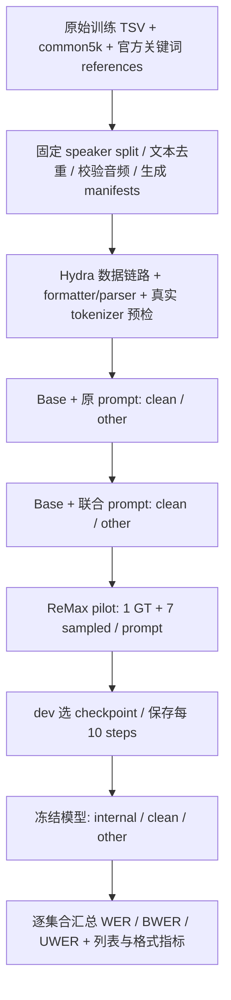

# LibriSpeech 转写与关键词联合输出

本轮仅做单段联合输出；连续 biasing 留在后续实验。代码位于独立分支 `boren/asr-transcription-keywords`。

## 配置布局与执行顺序

```text
2609-Keyword/
├── base.yaml
├── baseline_eval/
│   ├── eval_base_ls.yaml                 # A0：原 prompt、base、两套官方测试
│   └── eval_joint_prompt_ls.yaml         # A1：联合 prompt、base、两套官方测试
├── training/
│   └── remax_ls_joint_pilot.yaml         # A2：10k pilot，100 steps，dev 选 checkpoint
└── evaluation/
    └── eval_joint_checkpoint_ls.yaml     # A2：internal + 官方测试；必须指定训练后模型
```

顺序为 A0 → A1 → pilot → 冻结 checkpoint → A2。A0/A1 的 test-clean 和 test-other 均完成、结果条数与计数分区检查通过后再训练。训练只使用 train/dev，不用 official test 选 checkpoint 或调超参。



## 输出与监督

保留原有任务输出，追加大写 `<KEYWORDS>` 独占行；下一行用英文逗号分隔，按正文首次出现排序、去重。

```text
<src=English><tgt=English>
<VERBATIM>
asked jean valjean fauchelevent replied
<KEYWORDS>
fauchelevent
```

无关键词时保留头和空行。精确尾部字符串为 `"\n<KEYWORDS>\n\n"`。不输出结束标签；v1 仅单词，允许词内 apostrophe/hyphen，不支持短语或 CSV quoting。

- 原 prompt 追加 `keyword_output.KEYWORD_INSTRUCTION`；不把 reference 或目标关键词加入用户输入。
- `reward_model.ground_truth` 始终是正文字符串。原 reference 文件里的同名字段是关键词列表，builder 显式映射成 `keywords`。
- `gt_output` 是完整 assistant completion（含语言/模式头、正文、关键词块）；非空 assistant prefix 精确扣除。数据转换强制 round-trip 校验。
- `keyword_annotation_valid=true` 且 `keywords=[]` 才是有效空标注；缺标注会失败。
- 新协议为 opt-in `asr-keywords-v1`。旧任务不强制使用新 parser。
- 只有合法块才从正文剥离。缺头、坏头、重复、空项、额外解释和截断不给列表/格式奖励；坏尾部保留可见词计正文错误。
- 优先使用 rollout 传递的 vLLM 原生 finish_reason；stop 正常、length 截断，abort 等异常按超时失败处理。旧产物无该字段时才由 response mask/EOS/budget 回退推断，并记录来源。新协议 response mask 同时按真实返回 token 数限制，防止 PAD≠EOS 时把 padding 算作答案。

## 数据与准备

冻结 `ls-common5k-v1`：按 `r"[\w'\-]+"` 小写分词，排除 common5k，保留正文首次出现顺序。全部 5,559 条官方 keyword 标签与该规则完全一致。旧 `ls_rare05.yaml` 使用 common10k + 随机裁剪，不作为本轮标注规则。

输入：

- `/home/boren/data/LibriSpeech/asr_train_transcribe.tsv`（280,393 条）。
- `/home/boren/data/librispeech_biasing/ref/test-clean.biasing_100.jsonl`（2,620 条）。
- `/home/boren/data/librispeech_biasing/ref/test-other.biasing_100.jsonl`（2,939 条）。
- `/home/boren/data/librispeech_biasing/words/common_words_5k.txt`，SHA256 `30eadb83c338df9376e4fabd31bd1349becc06b896b81dbc5fb7dac6fca72a8e`。

已生成本地 manifests：`/home/boren/data/LibriSpeech/ls_joint_keywords_common5k_v1`。本轮限定本地已存在音频，因此从 raw TSV 排除 148,126 条本地缺失音频记录；这不是全量 LibriSpeech 训练。另排除 7 条与官方测试重复正文、9 条与 dev/internal 重复正文。speaker 按固定 hash 划分，集合不交叉。

| 集合 | 条数 | 非空 / 空目标 |
|---|---:|---:|
| train | 120,024 | 111,159 / 8,865 |
| pilot seed42 | 10,000 | 9,261 / 739 |
| dev | 6,096 | 5,671 / 425 |
| internal test | 6,131 | 5,806 / 325 |
| test-clean | 2,620 | 1,980 / 640 |
| test-other | 2,939 | 2,141 / 798 |

还生成了 `_remote` 目录，其 manifest 使用云端音频引用。**它仍在本机，尚未上传；云端音频可读性尚未验证。** 配置默认 manifest root 为 `az://orngwus2cresco/data/boren/data/LibriSpeech/ls_joint_keywords_common5k_v1`，可用 `keyword_experiment.manifest_root=...` 覆盖。

可复现 builder（拒绝覆盖已存在目录；换一个全新输出目录）：

```bash
python -m recipe.phimm.prepare_ls_keywords \
  --data-root /home/boren/data \
  --output-dir /home/boren/data/LibriSpeech/ls_joint_keywords_common5k_v1_new \
  --require-local-audio
```

云端引用增加 `--audio-prefix az://orngwus2cresco/data/boren/data`；上传该版本的 JSONL 和 metadata 到默认 manifest root，而不是上传含本机绝对音频路径的版本。先用 `bbb ls` / 小批读取确认存储与音频可用，再同步 worktree（`bpush`）到空闲 Ready GPU 节点。

## GPU 运行

以下在已同步、依赖就绪的远端 worktree 根目录运行。`quick_run.sh` 只提交 Ray job，返回不代表执行成功；须记录 job ID 并监控至完成。

```bash
bash quick_run.sh recipe/phimm/config/2609-Keyword/baseline_eval/eval_base_ls.yaml trainer.nnodes=1
bash quick_run.sh recipe/phimm/config/2609-Keyword/baseline_eval/eval_joint_prompt_ls.yaml trainer.nnodes=1
# 两项 baseline 完成后：
bash quick_run.sh recipe/phimm/config/2609-Keyword/training/remax_ls_joint_pilot.yaml trainer.nnodes=1
# dev 选择、导出并验证训练后 HF checkpoint 后：
bash quick_run.sh recipe/phimm/config/2609-Keyword/evaluation/eval_joint_checkpoint_ls.yaml \
  trainer.nnodes=1 actor_rollout_ref.model.path=/absolute/path/to/exported_trained_hf
```

基础 checkpoint 在 `base.yaml` 中冻结。LoRA rank256 / alpha512，导出时保留该参数，不套用其他实验的 rank320/alpha640。训练 n8，每组 1 条完整 GT + 7 条采样；greedy ReMax baseline、validation 和独立 eval 均禁止 GT。GT 组必须完整且 identity/target 一致；超 token budget 直接失败，禁止静默截断。100 steps，batch64，每 10 steps 保存，每 20 steps dev 验证。

reward 为原正文 ASR reward + `0.5 * kw_list_f1 + 0.1 * kw_block_fmt`。有效空目标/空预测 F1=1；缺块或坏块 F1=0，即使目标为空也不例外。

## 评估定义与结果

A0/A1/A2 使用同一词归一化、同一 unit-cost jiwer alignment，逐集合累计计数：

- `WER = Σn_err / Σn_ref`。
- `BWER = Σnb_err / Σnb_ref`：参考关键词位置上的替换/删除，以及预测词属于参考关键词集合的插入。
- `UWER = Σnu_err / Σnu_ref`，`NWER` 是同值别名。保持 `n_err=nb_err+nu_err`、`n_ref=nb_ref+nu_ref`。
- `keyword_word_accuracy = 1-BWER`，含插入惩罚，不等同于列表 Recall；极差结果可能为负。
- 联合输出另报列表 micro P/R/F1、macro F1、exact、格式成功率、空目标误报；不通过过滤预测词提高 Precision。
- 分母为 0 报 null/N/A；最终报告使用累计计数比值，不使用逐句 WER 的平均值。

这里采用 unit-cost alignment，与旧 `asr_bias.py` 的加权 alignment/子串关键词匹配不同。比较模型时须全部重评同一 scorer，不能直接拼接历史 BWER 数字。

验证逐条 JSONL 保存于 `${trainer.validation_data_dir}/ls_clean/<step>.jsonl` 等目录，下载一轮完整结果后：

```bash
python -m recipe.phimm.summarize_keyword_eval \
  /local/results/ls_clean/0.jsonl /local/results/ls_other/0.jsonl \
  --output /local/results/base_metrics.json
```

不混合不同 checkpoint step 或重复记录。训练后评估同理，增加 internal test 文件。正文主字段为 `parsed_transcription`，同时保留原始 `output`、关键词、协议状态及计数。

## 当前验证和执行状态

代码与配置已经实现；Hydra 配置、实际数据转换链路、真实 tokenizer 的 27,786 条 GT round-trip 已通过，全部 GT 含 EOS 长度小于 768。测试覆盖协议、空目标、错误格式、prefix、reward dispatcher、GT purpose/group/EOS/overflow 和计数汇总。详细证据在 `reports/asr_keywords_plan_20261023/`。

目前没有 GPU 模型评估或训练结果，也没有 Ray job ID。Brix Kubernetes 域名在 WSL 和 Windows 均解析失败；Blob 账号无可用访问凭据；本机没有 CUDA。恢复连接后按上述顺序继续执行，不能把 CPU GT 校验作为模型能力结果。
