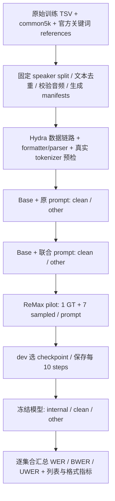

# LibriSpeech 转写与关键词联合输出

本轮仅做单段联合输出；连续 biasing 留在后续实验。代码位于独立分支 `boren/asr-transcription-keywords`。

## 配置布局与执行顺序

```text
v2609_kw/
├── base.yaml
├── data/
│   ├── training/
│   │   └── ls_pilot10k.yaml              # 仅 train pilot 10k
│   └── eval/
│       ├── ls_dev.yaml                   # 完整 dev，6,096 条，保留
│       ├── ls_dev_lowbwer1000.yaml       # 训练期间验证，baseline BWER 最低的 1,000 条
│       ├── ls_official.yaml              # test-clean + test-other，A0/A1 共用
│       └── ls_checkpoint.yaml            # internal + test-clean + test-other
├── baseline_eval/
│   ├── eval_base_ls.yaml                 # A0：原 prompt、base、两套官方测试
│   └── eval_joint_prompt_ls.yaml         # A1：联合 prompt、base、两套官方测试
├── training/
│   └── remax_ls_joint_pilot.yaml         # A2：10k pilot，100 steps，dev 选 checkpoint
└── evaluation/
    └── eval_joint_checkpoint_ls.yaml     # A2：internal + 官方测试；必须指定训练后模型
```

`data/` 仅定义 manifest、数据转换、数据源标记及 train/val 集合。训练数据放在 `data/training/`，验证和测试数据放在 `data/eval/`。`baseline_eval/`、`training/`、`evaluation/` 中的入口 YAML 通过 Hydra defaults 组合 `base.yaml` 和对应数据 YAML，仅保留 prompt 开关、rollout 和执行设置。A0/A1 共用 `data/eval/ls_official.yaml`；训练分别加载 `data/training/ls_pilot10k.yaml` 与 `data/eval/ls_dev_lowbwer1000.yaml`。修改模型、学习率或训练步数无需编辑数据文件。文件夹名称为 `v2609_kw`；已有 W&B project 与云端结果目录仍为 `2609-Keyword`，保留实验连续性。

顺序为 A0 → A1 → pilot → 冻结 checkpoint → A2。A0/A1 的 test-clean 和 test-other 均完成、结果条数与计数分区检查通过后再训练。训练只使用 train/dev，不用 official test 选 checkpoint 或调超参。



## 输出与监督

保留原有任务输出，追加大写 `<KEYWORDS>` 独占行；下一行用英文逗号分隔，按正文首次出现排序、去重。

```text
<src=English><tgt=English>
<VERBATIM>
asked jean valjean fauchelevent replied
<KEYWORDS>
fauchelevent
```

无关键词时保留头和空行。精确尾部字符串为 `"\n<KEYWORDS>\n\n"`。不输出结束标签；v1 仅单词，允许词内 apostrophe/hyphen，不支持短语或 CSV quoting。

- 原 prompt 追加 `keyword_output.KEYWORD_INSTRUCTION`；不把 reference 或目标关键词加入用户输入。
- `reward_model.ground_truth` 始终是正文字符串。原 reference 文件里的同名字段是关键词列表，builder 显式映射成 `keywords`。
- `gt_output` 是完整 assistant completion（含语言/模式头、正文、关键词块）；非空 assistant prefix 精确扣除。数据转换强制 round-trip 校验。
- `keyword_annotation_valid=true` 且 `keywords=[]` 才是有效空标注；缺标注会失败。
- 新协议为 opt-in `asr-keywords-v1`。旧任务不强制使用新 parser。
- 只有合法块才从正文剥离。缺头、坏头、重复、空项、额外解释和截断不给列表/格式奖励；坏尾部保留可见词计正文错误。
- 优先使用 rollout 传递的 vLLM 原生 finish_reason；stop 正常、length 截断，abort 等异常按超时失败处理。旧产物无该字段时才由 response mask/EOS/budget 回退推断，并记录来源。新协议 response mask 同时按真实返回 token 数限制，防止 PAD≠EOS 时把 padding 算作答案。

## 真实数据：处理前与处理后

以下是实际 manifest 记录，经当前配置的 `augment()`（`add_task_info` → `add_field` → `verl_format_ds`）处理后的结果。这里“处理前”指 loader 读取的已准备 JSONL，已完成关键词标注和数据划分；不是原始 TSV。为便于阅读，省略 speaker/chapter 与 hash 等元数据，音频路径在处理后保持不变。

### 训练样本

配置：[training/remax_ls_joint_pilot.yaml](training/remax_ls_joint_pilot.yaml)，数据：[data/training/ls_pilot10k.yaml](data/training/ls_pilot10k.yaml)。输入 manifest 为 `${keyword_experiment.manifest_root}/train_pilot10k_seed42.jsonl`。

处理前：

```yaml
id: 4018-103416-0012
text: no toots dear but i can easily mother marion explained
keywords: [toots, marion]
audio_path: az://orngwus2cresco/data/boren/data/LibriSpeech/train-clean-100/4018/103416/4018-103416-0012.flac
split: train
keyword_annotation_valid: true
annotation_policy: ls-common5k-v1
```

处理后，`prompt` 是一条 `role: user` 消息，`content` 为下文。训练和 A1 联合输出评估使用相同 prompt，具体目标词不放入 prompt。

```text
Transcribe the audio clip into text. Transcribe verbatim, including all filler words and disfluencies.<audio>
The language is English.
Also output the rare words that occur in this audio. After the complete transcription, write <KEYWORDS> on a new line, then a comma-separated list on the next line. List each word once, in its order of first occurrence. If there are no keywords, leave that line empty. Do not add explanations.
```

处理后的参考字段：

```yaml
data_source: ls_joint_train
reward_model:
  ground_truth: no toots dear but i can easily mother marion explained
  gt_group_id: 4018-103416-0012
  output_protocol: asr-keywords-v1
  gt_output: |
    <src=English><tgt=English>
    <VERBATIM>
    no toots dear but i can easily mother marion explained
    <KEYWORDS>
    toots, marion
extra_info:
  id: 4018-103416-0012
  keywords: [toots, marion]
  language: English
  prefix: ""
  output_protocol: asr-keywords-v1
  keyword_annotation_valid: true
```

`ground_truth` 只保存转写正文。`gt_output` 是完整的格式化目标答案，用于训练采样阶段的 GT rollout；每组 1 条 GT completion + 7 条 sampled completions。当前 `prefix_prob: 0.0`，因此 `prefix` 为空，GT 中保留完整任务头。

### 评估样本：A1 联合输出

配置：[baseline_eval/eval_joint_prompt_ls.yaml](baseline_eval/eval_joint_prompt_ls.yaml)，数据：[data/eval/ls_official.yaml](data/eval/ls_official.yaml)。输入 manifest 为 `${keyword_experiment.manifest_root}/test_clean.jsonl`。

处理前：

```yaml
id: 1089-134686-0001
text: stuff it into you his belly counselled him
keywords: [belly, counselled]
audio_path: az://orngwus2cresco/data/boren/data/LibriSpeech/test-clean/1089/134686/1089-134686-0001.flac
split: test-clean
keyword_annotation_valid: true
annotation_policy: ls-common5k-v1
```

处理后，`prompt` 使用上面相同的联合输出指令；参考字段为：

```yaml
data_source: ls_clean
reward_model:
  ground_truth: stuff it into you his belly counselled him
  gt_group_id: 1089-134686-0001
  output_protocol: asr-keywords-v1
  gt_output: |
    <src=English><tgt=English>
    <VERBATIM>
    stuff it into you his belly counselled him
    <KEYWORDS>
    belly, counselled
extra_info:
  id: 1089-134686-0001
  keywords: [belly, counselled]
  language: English
  prefix: ""
  output_protocol: asr-keywords-v1
  keyword_annotation_valid: true
```

评估时 `gt_rollout: false`：reference/关键词标签仅用于评分，不作为模型输入，也不替换预测。上面的 `gt_output` 是参考答案示例，不是模型生成结果。dev 验证同样不使用 GT rollout。

### A0 原 prompt 的区别

[baseline_eval/eval_base_ls.yaml](baseline_eval/eval_base_ls.yaml) 读取相同评估记录，但设置 `output_keywords: false`，prompt 为：

```text
Transcribe the audio clip into text. Transcribe verbatim, including all filler words and disfluencies.<audio>
The language is English.
```

同一条评估记录的 `reward_model.gt_output` 不含关键词块：

```text
<src=English><tgt=English>
<VERBATIM>
stuff it into you his belly counselled him
```

A0 的 `reward_model.ground_truth` 仍是正文，`extra_info.keywords` 仍为 `[belly, counselled]`，用于计算 BWER；不添加 `asr-keywords-v1` 协议字段。联合输出的有效空关键词目标则保留精确尾部 `"\n<KEYWORDS>\n\n"`。

以上展示文本与 schema 转换；`RLHFDataset.__getitem__()` 随后才加载音频、应用 chat template，并构建音频特征与 token tensors。

## 数据与准备

冻结 `ls-common5k-v1`：按 `r"[\w'\-]+"` 小写分词，排除 common5k，保留正文首次出现顺序。全部 5,559 条官方 keyword 标签与该规则完全一致。旧 `ls_rare05.yaml` 使用 common10k + 随机裁剪，不作为本轮标注规则。

输入：

- `/home/boren/data/LibriSpeech/asr_train_transcribe.tsv`（280,393 条）。
- `/home/boren/data/librispeech_biasing/ref/test-clean.biasing_100.jsonl`（2,620 条）。
- `/home/boren/data/librispeech_biasing/ref/test-other.biasing_100.jsonl`（2,939 条）。
- `/home/boren/data/librispeech_biasing/words/common_words_5k.txt`，SHA256 `30eadb83c338df9376e4fabd31bd1349becc06b896b81dbc5fb7dac6fca72a8e`。

已生成本地 manifests：`/home/boren/data/LibriSpeech/ls_joint_keywords_common5k_v1`。本轮限定本地已存在音频，因此从 raw TSV 排除 148,126 条本地缺失音频记录；这不是全量 LibriSpeech 训练。另排除 7 条与官方测试重复正文、9 条与 dev/internal 重复正文。speaker 按固定 hash 划分，集合不交叉。

| 集合 | 条数 | 非空 / 空目标 |
|---|---:|---:|
| train | 120,024 | 111,159 / 8,865 |
| pilot seed42 | 10,000 | 9,261 / 739 |
| full dev（保留） | 6,096 | 5,671 / 425 |
| training validation：dev low-BWER 1000 | 1,000 | 1,000 / 0 |
| internal test | 6,131 | 5,806 / 325 |
| test-clean | 2,620 | 1,980 / 640 |
| test-other | 2,939 | 2,141 / 798 |

还生成了 `_remote` 目录，其 manifest 使用云端音频引用。云端引用版已上传；5,559 条官方测试音频在主节点缓存就绪，训练/dev/internal 已各抽样验证音频可读，尚未做全量训练音频审计。 配置默认 manifest root 为 `az://orngwus2cresco/data/boren/data/LibriSpeech/ls_joint_keywords_common5k_v1`，可用 `keyword_experiment.manifest_root=...` 覆盖。

可复现 builder（拒绝覆盖已存在目录；换一个全新输出目录）：

```bash
python -m recipe.phimm.prepare_ls_keywords \
  --data-root /home/boren/data \
  --output-dir /home/boren/data/LibriSpeech/ls_joint_keywords_common5k_v1_new \
  --require-local-audio
```

云端引用增加 `--audio-prefix az://orngwus2cresco/data/boren/data`；上传该版本的 JSONL 和 metadata 到默认 manifest root，而不是上传含本机绝对音频路径的版本。先用 `bbb ls` / 小批读取确认存储与音频可用，再同步 worktree（`bpush`）到空闲 Ready GPU 节点。

## GPU 运行

以下在已同步、依赖就绪的远端 worktree 根目录运行。`quick_run.sh` 只提交 Ray job，返回不代表执行成功；须记录 job ID 并监控至完成。

```bash
bash quick_run.sh recipe/phimm/config/v2609_kw/baseline_eval/eval_base_ls.yaml trainer.nnodes=2
bash quick_run.sh recipe/phimm/config/v2609_kw/baseline_eval/eval_joint_prompt_ls.yaml trainer.nnodes=2
# 两项 baseline 完成后：
bash quick_run.sh recipe/phimm/config/v2609_kw/training/remax_ls_joint_pilot.yaml trainer.nnodes=2 trainer.experiment_name=remax_ls_joint_pilot_dev1k
# dev 选择、导出并验证训练后 HF checkpoint 后：
bash quick_run.sh recipe/phimm/config/v2609_kw/evaluation/eval_joint_checkpoint_ls.yaml \
  trainer.nnodes=2 actor_rollout_ref.model.path=/absolute/path/to/exported_trained_hf
```

基础 checkpoint 在 `base.yaml` 中冻结。LoRA rank256 / alpha512，导出时保留该参数，不套用其他实验的 rank320/alpha640。训练 n8，每组 1 条完整 GT + 7 条采样；greedy ReMax baseline、validation 和独立 eval 均禁止 GT。GT 组必须完整且 identity/target 一致；超 token budget 直接失败，禁止静默截断。100 steps，batch64，每 10 steps 保存，每 20 steps dev 验证。

reward 为原正文 ASR reward + `0.5 * kw_list_f1 + 0.1 * kw_block_fmt`。有效空目标/空预测 F1=1；缺块或坏块 F1=0，即使目标为空也不例外。

## 评估定义与结果

A0/A1/A2 使用同一词归一化、同一 unit-cost jiwer alignment，逐集合累计计数：

- `WER = Σn_err / Σn_ref`。
- `BWER = Σnb_err / Σnb_ref`：参考关键词位置上的替换/删除，以及预测词属于参考关键词集合的插入。
- `UWER = Σnu_err / Σnu_ref`，`NWER` 是同值别名。保持 `n_err=nb_err+nu_err`、`n_ref=nb_ref+nu_ref`。
- `keyword_word_accuracy = 1-BWER`，含插入惩罚，不等同于列表 Recall；极差结果可能为负。
- 联合输出另报列表 micro P/R/F1、macro F1、exact、格式成功率、空目标误报；不通过过滤预测词提高 Precision。
- 分母为 0 报 null/N/A；最终报告使用累计计数比值，不使用逐句 WER 的平均值。

这里采用 unit-cost alignment，与旧 `asr_bias.py` 的加权 alignment/子串关键词匹配不同。比较模型时须全部重评同一 scorer，不能直接拼接历史 BWER 数字。

验证逐条 JSONL 保存于 `${trainer.validation_data_dir}/ls_clean/<step>.jsonl` 等目录，下载一轮完整结果后：

```bash
python -m recipe.phimm.summarize_keyword_eval \
  /local/results/ls_clean/0.jsonl /local/results/ls_other/0.jsonl \
  --output /local/results/base_metrics.json
```

不混合不同 checkpoint step 或重复记录。训练后评估同理，增加 internal test 文件。正文主字段为 `parsed_transcription`，同时保留原始 `output`、关键词、协议状态及计数。

## 当前验证和执行状态

代码与配置已经实现；Hydra 配置、实际数据转换链路、真实 tokenizer 的 27,786 条 GT round-trip 已通过，全部 GT 含 EOS 长度小于 768。测试覆盖协议、空目标、错误格式、prefix、reward dispatcher、GT purpose/group/EOS/overflow 和计数汇总。详细证据在 `reports/asr_keywords_plan_20261023/`。

Brix/Blob 已恢复。A0 已完成，Ray job 为 `raysubmit_8QYAUSqkEcEr7Ji8`，使用代码快照 `5307f0132` 和重命名前的配置路径。已验证完整 5,559 条结果：test-clean WER 2.36%、BWER 7.79%；test-other WER 4.16%、BWER 15.21%。主节点测试音频缓存 5,559 条就绪；A1 与训练尚未启动。父分支 `origin/boren/rl_2611_dev` 的 `d34b3ba28` 已无冲突合并到本分支；下一个 job 提交前同步新配置。最近检查发现 `verl-n2-i10` 被其他训练占用，因此等待资源空闲后继续。实时进度以 `reports/asr_keywords_plan_20261023/execution_status.json` 和实际 Ray 状态为准，每 30 分钟自动跟进与修复。


### 训练期间的 1,000 条验证集

训练入口改为加载 `data/eval/ls_dev_lowbwer1000.yaml`。从原有 6,096 条 dev 的未训练模型 step-0 联合 prompt 结果中，按逐句 `nb_err/nb_ref`（BWER）升序选取 1,000 条；同分时依次按 `n_err/n_ref`（WER）和 utterance ID 排序，比例使用精确分数。排除 `nb_ref=0` 的 425 条，BWER 对这些样本无定义。保留原始 manifest 字段和 dev split，不改关键词标签、音频或 GT 构造。

这是用户指定的容易子集，适合快速训练验证和 checkpoint 选择，基线可能已达到 BWER=0，无法衡量广泛难例或空关键词表现。最终泛化质量仍由完整 internal test、test-clean、test-other 衡量；这些测试不参与筛选。完整 `dev.jsonl` 与 `ls_dev.yaml` 保留，官方测试配置保持原样。

筛选器要求 baseline 完整覆盖 dev、step=0、data_source=ls_dev，并核对 reference、keywords、annotation/source hashes、唯一 ID 和 WER 计数分区。冻结后的 JSONL 与 provenance 一同上传，训练使用独立 cache/source `ls_dev_lowbwer1000`。新运行名为 `remax_ls_joint_pilot_dev1k`，避免与历史 full-dev 验证混合；提交时须显式传入该 experiment_name（quick_run 默认使用配置文件名）。

```bash
python -m recipe.phimm.select_keyword_validation \
  --manifest /home/boren/data/LibriSpeech/ls_joint_keywords_common5k_v1_remote/dev.jsonl \
  --baseline tmp/verl_asr_run/keyword_joint_pipeline/dev_baseline/0.jsonl \
  --output /home/boren/data/LibriSpeech/ls_joint_keywords_common5k_v1_remote/dev_lowbwer1000_step0_v1.jsonl \
  --provenance reports/asr_keywords_plan_20261023/dev_lowbwer1000_selection.json
```

冻结结果：1,000 条、34,583 个正文 reference words、3,427 个 keyword reference words；筛选时的 baseline WER/BWER/UWER 均为 0%。这不代表 keyword 列表已正确输出（base 模型未输出列表）。完整名单与计数见 `reports/asr_keywords_plan_20261023/dev_lowbwer1000_selection.json`。
