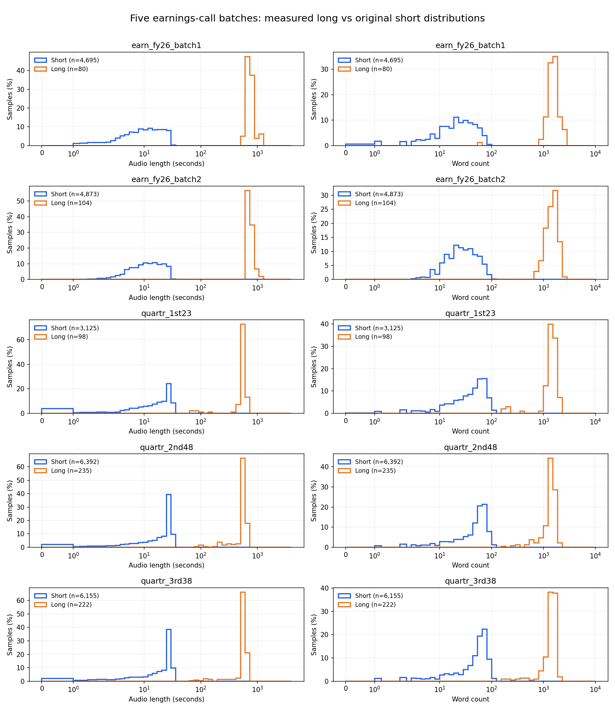

# Base3a SL：五批 Long-form / Short-form 数据统计

Updated: 2026-11-13 20:28 PST

五批 long-form 已分别转入 Orange 并按 Base3a 文本、任务和奖励格式准备；所有新 parent sample 均有以秒计的 `audio_length`。对应 short-form 来自原 Base3a 训练清单。以下是输入数据统计，尚无候选模型质量结论。

## 汇总与统计口径

| 批次 | 版本 | recording groups | sample 数 | 总时长 h | 平均秒 | P50 秒 | P95 秒 | 平均 words | P50 words | P95 words |
|---|---|---:|---:|---:|---:|---:|---:|---:|---:|---:|
| earn_fy26_batch1 | short | 35 | 4,695 | 15.304944 | 11.74 | 9.96 | 26.81 | 26.67 | 22.0 | 64.0 |
| earn_fy26_batch1 | long | 35 | 80 | 16.753794 | 753.92 | 723.24 | 1123.69 | 1564.99 | 1552.5 | 2365.0 |
| earn_fy26_batch2 | short | 39 | 4,873 | 17.444889 | 12.89 | 11.42 | 26.90 | 31.70 | 27.0 | 71.0 |
| earn_fy26_batch2 | long | 39 | 104 | 21.041857 | 728.37 | 693.40 | 899.79 | 1485.10 | 1483.0 | 2123.6 |
| quartr_1st23 | short | 23 | 3,125 | 15.031996 | 17.32 | 17.63 | 30.14 | 44.50 | 44.0 | 88.0 |
| quartr_1st23 | long | 23 | 98 | 15.031996 | 552.20 | 597.93 | 611.58 | 1418.96 | 1454.0 | 1878.0 |
| quartr_2nd48 | short | 48 | 6,392 | 35.836268 | 20.18 | 24.11 | 29.91 | 49.47 | 54.0 | 87.0 |
| quartr_2nd48 | long | 48 | 235 | 35.834968 | 548.96 | 598.06 | 612.19 | 1345.39 | 1429.0 | 1792.6 |
| quartr_3rd38 | short | 35 | 6,155 | 34.211219 | 20.01 | 23.70 | 29.90 | 50.24 | 55.0 | 89.0 |
| quartr_3rd38 | long | 35 | 222 | 34.211219 | 554.78 | 598.11 | 612.89 | 1391.84 | 1463.0 | 1797.5 |

long 合计：**739 samples / 122.873834 h**；加权平均 598.57 秒、1412.53 words。

segments 合计：**25,240 samples / 117.829317 h**；加权平均 16.81 秒、41.37 words。

计数单位为实际音频 sample。FY26 的 8/11 个 `.audio` 容器分别包含 80/104 个样本；sidecar、packed 副本不重复计数。Quartr 为 98/235/222 个 WAV chunk。FY26 recording groups 是从文件名去除 `_partNNN` 或 `_segN` 推断的录音组，非供应方 event ID。

时长：FY26 全部 long/short 及 Quartr 全部 long 已读取 WAV header 核对帧数/采样率；Quartr short 使用原 manifest 时长。word count 是实际 Base3a `clean_tagged_text` 清洗后按空白切词，非 tokenizer token 数。空文本仍计入分母。分位数用 numpy linear interpolation；分布为左闭右开，最后一桶无上限。

## Long / short 的差异

FY26 两批 long 与原配置中名为 FY27 的 short 清单，录音文件集合逐批完全匹配（35/39 组）。但两批音频总时长均增加；Batch1 清洗后总词数相同（不证明文本逐词一致），Batch2 少38词。不能把本实验解释为仅修改分段长度。Quartr 也存在文本清洗/拼接差异。

| 批次 | long−short 时长秒 | long−short words | sample 压缩比 short/long |
|---|---:|---:|---:|
| earn_fy26_batch1 | +5215.858312 | +0 | 58.69× |
| earn_fy26_batch2 | +12949.083688 | -38 | 46.86× |
| quartr_1st23 | -0.000000 | -5 | 31.89× |
| quartr_2nd48 | -4.680000 | -16 | 27.20× |
| quartr_3rd38 | -0.000000 | -266 | 27.73× |

Second48：`Input_WAV_Count` 合计 6,391，对应 short 6,392；差异定位在 `event_35315`，总时长少 4.680 秒。该事件 `event_35315_seg66` 恰为 4.68 秒，但计数及同长只能提供候选，尚未证明具体遗漏。Final38 实际观察到 35 个 event ID；chunk 路径使用 `Record_Filename`，`Event_Audio` 指向拼接父录音。

训练用 SL 保留随机 5–30 秒划分、`segment_count=null`、seed42、`max_audio_dur=null`，参考文本仍为完整 parent。这里的 short sample 数不是 SL 运行时产生的 segment 数；运行时 segment 数随随机划分而定，未用固定估算冒充实际计数。

## 每批分位数和完整分布

### earn_fy26_batch1

**short**：samples=4695; recording_groups=35; audio_total_seconds=55097.800000; audio_hours=15.304944444; audio_mean_seconds=11.735421; words_total=125199; words_mean=26.666454; empty_cleaned_references=26

- audio 秒：min=1.000000; p25=5.410000; p50=9.960000; p75=17.140000; p90=23.740000; p95=26.813000; p99=29.311200; max=29.990000
- word count：min=0.000000; p25=12.000000; p50=22.000000; p75=38.500000; p90=55.000000; p95=64.000000; p99=77.000000; max=94.000000
- 时长分桶（sample 数及比例）：[0,5)=1058 (22.5346%); [5,10)=1299 (27.6677%); [10,15)=884 (18.8285%); [15,20)=614 (13.0777%); [20,30)=840 (17.8914%); [30,40)=0 (0.0000%); [40,60)=0 (0.0000%); [60,120)=0 (0.0000%); [120,300)=0 (0.0000%); [300,600)=0 (0.0000%); [600,900)=0 (0.0000%); [900,1200)=0 (0.0000%); [1200,1800)=0 (0.0000%); [1800,3600)=0 (0.0000%); [3600,inf)=0 (0.0000%)
- 词数分桶（sample 数及比例）：[0,25)=2563 (54.5900%); [25,50)=1477 (31.4590%); [50,75)=574 (12.2258%); [75,100)=81 (1.7252%); [100,150)=0 (0.0000%); [150,200)=0 (0.0000%); [200,300)=0 (0.0000%); [300,500)=0 (0.0000%); [500,1000)=0 (0.0000%); [1000,1500)=0 (0.0000%); [1500,2000)=0 (0.0000%); [2000,inf)=0 (0.0000%)

**long**：samples=80; recording_groups=35; audio_total_seconds=60313.658312; audio_hours=16.753793976; audio_mean_seconds=753.920729; words_total=125199; words_mean=1564.987500; empty_cleaned_references=0

- audio 秒：min=601.584812; p25=654.650000; p50=723.240000; p75=822.267656; p90=877.762000; p95=1123.685600; p99=1193.976334; max=1206.386937
- word count：min=55.000000; p25=1299.000000; p50=1552.500000; p75=1728.250000; p90=2081.000000; p95=2365.000000; p99=2580.730000; max=2670.000000
- 时长分桶（sample 数及比例）：[0,5)=0 (0.0000%); [5,10)=0 (0.0000%); [10,15)=0 (0.0000%); [15,20)=0 (0.0000%); [20,30)=0 (0.0000%); [30,40)=0 (0.0000%); [40,60)=0 (0.0000%); [60,120)=0 (0.0000%); [120,300)=0 (0.0000%); [300,600)=0 (0.0000%); [600,900)=74 (92.5000%); [900,1200)=5 (6.2500%); [1200,1800)=1 (1.2500%); [1800,3600)=0 (0.0000%); [3600,inf)=0 (0.0000%)
- 词数分桶（sample 数及比例）：[0,25)=0 (0.0000%); [25,50)=0 (0.0000%); [50,75)=1 (1.2500%); [75,100)=0 (0.0000%); [100,150)=0 (0.0000%); [150,200)=0 (0.0000%); [200,300)=0 (0.0000%); [300,500)=0 (0.0000%); [500,1000)=2 (2.5000%); [1000,1500)=32 (40.0000%); [1500,2000)=32 (40.0000%); [2000,inf)=13 (16.2500%)

来源：`https://highperf01safn.blob.core.windows.net/data/users/qimiao/EarningsCall_FY26/Chunks/Batch1/`

Orange：`az://orngwus2cresco/data/speech/users/qimiao/EarningsCall_FY26/Chunks/Batch1/`

训练 JSONL：`az://orngwus2cresco/data/speech/users/qimiao/EarningsCall_FY26/Chunks/Batch1/training_base3a_v1/earn_fy26_batch1.jsonl`

原 short 清单：`az://orngwus2cresco/data/speech/EarningsCall_2026_conversion_svad/earningscall-fy27-en-us-batch1.jsonl`

### earn_fy26_batch2

**short**：samples=4873; recording_groups=39; audio_total_seconds=62801.600000; audio_hours=17.444888889; audio_mean_seconds=12.887667; words_total=154488; words_mean=31.702852; empty_cleaned_references=1

- audio 秒：min=1.120000; p25=6.800000; p50=11.420000; p75=18.030000; p90=24.088000; p95=26.904000; p99=29.382800; max=29.990000
- word count：min=0.000000; p25=17.000000; p50=27.000000; p75=43.000000; p90=61.000000; p95=71.000000; p99=87.000000; max=116.000000
- 时长分桶（sample 数及比例）：[0,5)=629 (12.9079%); [5,10)=1455 (29.8584%); [10,15)=1085 (22.2655%); [15,20)=741 (15.2062%); [20,30)=963 (19.7620%); [30,40)=0 (0.0000%); [40,60)=0 (0.0000%); [60,120)=0 (0.0000%); [120,300)=0 (0.0000%); [300,600)=0 (0.0000%); [600,900)=0 (0.0000%); [900,1200)=0 (0.0000%); [1200,1800)=0 (0.0000%); [1800,3600)=0 (0.0000%); [3600,inf)=0 (0.0000%)
- 词数分桶（sample 数及比例）：[0,25)=2176 (44.6542%); [25,50)=1762 (36.1584%); [50,75)=747 (15.3294%); [75,100)=181 (3.7143%); [100,150)=7 (0.1436%); [150,200)=0 (0.0000%); [200,300)=0 (0.0000%); [300,500)=0 (0.0000%); [500,1000)=0 (0.0000%); [1000,1500)=0 (0.0000%); [1500,2000)=0 (0.0000%); [2000,inf)=0 (0.0000%)

**long**：samples=104; recording_groups=39; audio_total_seconds=75750.683688; audio_hours=21.041856580; audio_mean_seconds=728.371959; words_total=154450; words_mean=1485.096154; empty_cleaned_references=0

- audio 秒：min=613.596500; p25=638.263500; p50=693.400500; p75=784.316063; p90=881.489369; p95=899.791097; p99=1072.575212; max=1191.648125
- word count：min=712.000000; p25=1213.500000; p50=1483.000000; p75=1738.500000; p90=1980.700000; p95=2123.650000; p99=2275.940000; max=2360.000000
- 时长分桶（sample 数及比例）：[0,5)=0 (0.0000%); [5,10)=0 (0.0000%); [10,15)=0 (0.0000%); [15,20)=0 (0.0000%); [20,30)=0 (0.0000%); [30,40)=0 (0.0000%); [40,60)=0 (0.0000%); [60,120)=0 (0.0000%); [120,300)=0 (0.0000%); [300,600)=0 (0.0000%); [600,900)=98 (94.2308%); [900,1200)=6 (5.7692%); [1200,1800)=0 (0.0000%); [1800,3600)=0 (0.0000%); [3600,inf)=0 (0.0000%)
- 词数分桶（sample 数及比例）：[0,25)=0 (0.0000%); [25,50)=0 (0.0000%); [50,75)=0 (0.0000%); [75,100)=0 (0.0000%); [100,150)=0 (0.0000%); [150,200)=0 (0.0000%); [200,300)=0 (0.0000%); [300,500)=0 (0.0000%); [500,1000)=10 (9.6154%); [1000,1500)=43 (41.3462%); [1500,2000)=42 (40.3846%); [2000,inf)=9 (8.6538%)

来源：`https://highperf01safn.blob.core.windows.net/data/users/qimiao/EarningsCall_FY26/Chunks/Batch2/`

Orange：`az://orngwus2cresco/data/speech/users/qimiao/EarningsCall_FY26/Chunks/Batch2/`

训练 JSONL：`az://orngwus2cresco/data/speech/users/qimiao/EarningsCall_FY26/Chunks/Batch2/training_base3a_v1/earn_fy26_batch2.jsonl`

原 short 清单：`az://orngwus2cresco/data/speech/earningscall-2026/batch2-raw/EarningsCall_2026_batch2-raw_conversion_svad/earningscall-fy27-en-us-batch2.jsonl`

### quartr_1st23_long

**short**：samples=3125; recording_groups=23; audio_total_seconds=54115.187000; audio_hours=15.031996389; audio_mean_seconds=17.316860; words_total=139063; words_mean=44.500160; empty_cleaned_references=6

- audio 秒：min=0.160000; p25=8.390000; p50=17.630000; p75=27.283000; p90=29.618200; p95=30.138000; p99=32.185600; max=32.975000
- word count：min=0.000000; p25=22.000000; p50=44.000000; p75=65.000000; p90=79.000000; p95=88.000000; p99=102.760000; max=124.000000
- 时长分桶（sample 数及比例）：[0,5)=424 (13.5680%); [5,10)=497 (15.9040%); [10,15)=426 (13.6320%); [15,20)=416 (13.3120%); [20,30)=1199 (38.3680%); [30,40)=163 (5.2160%); [40,60)=0 (0.0000%); [60,120)=0 (0.0000%); [120,300)=0 (0.0000%); [300,600)=0 (0.0000%); [600,900)=0 (0.0000%); [900,1200)=0 (0.0000%); [1200,1800)=0 (0.0000%); [1800,3600)=0 (0.0000%); [3600,inf)=0 (0.0000%)
- 词数分桶（sample 数及比例）：[0,25)=888 (28.4160%); [25,50)=868 (27.7760%); [50,75)=925 (29.6000%); [75,100)=398 (12.7360%); [100,150)=46 (1.4720%); [150,200)=0 (0.0000%); [200,300)=0 (0.0000%); [300,500)=0 (0.0000%); [500,1000)=0 (0.0000%); [1000,1500)=0 (0.0000%); [1500,2000)=0 (0.0000%); [2000,inf)=0 (0.0000%)

**long**：samples=98; recording_groups=23; audio_total_seconds=54115.187000; audio_hours=15.031996389; audio_mean_seconds=552.195786; words_total=139058; words_mean=1418.959184; empty_cleaned_references=0

- audio 秒：min=65.413000; p25=590.445000; p50=597.930000; p75=603.044250; p90=608.576700; p95=611.584000; p99=613.880345; max=614.376500
- word count：min=171.000000; p25=1310.500000; p50=1454.000000; p75=1662.000000; p90=1839.500000; p95=1878.000000; p99=1937.890000; max=1999.000000
- 时长分桶（sample 数及比例）：[0,5)=0 (0.0000%); [5,10)=0 (0.0000%); [10,15)=0 (0.0000%); [15,20)=0 (0.0000%); [20,30)=0 (0.0000%); [30,40)=0 (0.0000%); [40,60)=0 (0.0000%); [60,120)=5 (5.1020%); [120,300)=1 (1.0204%); [300,600)=54 (55.1020%); [600,900)=38 (38.7755%); [900,1200)=0 (0.0000%); [1200,1800)=0 (0.0000%); [1800,3600)=0 (0.0000%); [3600,inf)=0 (0.0000%)
- 词数分桶（sample 数及比例）：[0,25)=0 (0.0000%); [25,50)=0 (0.0000%); [50,75)=0 (0.0000%); [75,100)=0 (0.0000%); [100,150)=0 (0.0000%); [150,200)=3 (3.0612%); [200,300)=2 (2.0408%); [300,500)=1 (1.0204%); [500,1000)=1 (1.0204%); [1000,1500)=49 (50.0000%); [1500,2000)=42 (42.8571%); [2000,inf)=0 (0.0000%)

来源：`https://highperf01eus2.blob.core.windows.net/data/users/qimiao/EarningsCall_Quartr_FY27_Batch1_Partial_First23events_Cleaned/10min-chunks/`

Orange：`az://orngwus2cresco/data/speech/users/qimiao/EarningsCall_Quartr_FY27_Batch1_Partial_First23events_Cleaned/10min-chunks/`

训练 JSONL：`az://orngwus2cresco/data/speech/users/qimiao/EarningsCall_Quartr_FY27_Batch1_Partial_First23events_Cleaned/10min-chunks/training_base3a_v1/quartr_1st23_long.jsonl`

原 short 清单：`az://orngwus2cresco/data/speech/users/qimiao/EarningsCall_Quartr_FY27_Batch1_Partial_First23events_Cleaned/earningscall-quartr-fy27-batch1-first23events-cleaned.jsonl`

### quartr_2nd48_long

**short**：samples=6392; recording_groups=48; audio_total_seconds=129010.565000; audio_hours=35.836268056; audio_mean_seconds=20.183130; words_total=316183; words_mean=49.465426; empty_cleaned_references=2

- audio 秒：min=0.100000; p25=11.115000; p50=24.110000; p75=29.220000; p90=29.748900; p95=29.911000; p99=31.440900; max=32.990000
- word count：min=0.000000; p25=28.000000; p50=54.000000; p75=69.000000; p90=81.000000; p95=87.000000; p99=101.000000; max=126.000000
- 时长分桶（sample 数及比例）：[0,5)=750 (11.7334%); [5,10)=704 (11.0138%); [10,15)=611 (9.5588%); [15,20)=612 (9.5745%); [20,30)=3581 (56.0232%); [30,40)=134 (2.0964%); [40,60)=0 (0.0000%); [60,120)=0 (0.0000%); [120,300)=0 (0.0000%); [300,600)=0 (0.0000%); [600,900)=0 (0.0000%); [900,1200)=0 (0.0000%); [1200,1800)=0 (0.0000%); [1800,3600)=0 (0.0000%); [3600,inf)=0 (0.0000%)
- 词数分桶（sample 数及比例）：[0,25)=1425 (22.2935%); [25,50)=1366 (21.3705%); [50,75)=2546 (39.8310%); [75,100)=971 (15.1909%); [100,150)=84 (1.3141%); [150,200)=0 (0.0000%); [200,300)=0 (0.0000%); [300,500)=0 (0.0000%); [500,1000)=0 (0.0000%); [1000,1500)=0 (0.0000%); [1500,2000)=0 (0.0000%); [2000,inf)=0 (0.0000%)

**long**：samples=235; recording_groups=48; audio_total_seconds=129005.885000; audio_hours=35.834968056; audio_mean_seconds=548.961213; words_total=316167; words_mean=1345.391489; empty_cleaned_references=0

- audio 秒：min=76.606000; p25=588.805000; p50=598.060000; p75=604.785750; p90=610.250400; p95=612.187650; p99=614.176890; max=663.280000
- word count：min=175.000000; p25=1232.000000; p50=1429.000000; p75=1546.000000; p90=1690.800000; p95=1792.600000; p99=1909.560000; max=1957.000000
- 时长分桶（sample 数及比例）：[0,5)=0 (0.0000%); [5,10)=0 (0.0000%); [10,15)=0 (0.0000%); [15,20)=0 (0.0000%); [20,30)=0 (0.0000%); [30,40)=0 (0.0000%); [40,60)=0 (0.0000%); [60,120)=5 (2.1277%); [120,300)=16 (6.8085%); [300,600)=114 (48.5106%); [600,900)=100 (42.5532%); [900,1200)=0 (0.0000%); [1200,1800)=0 (0.0000%); [1800,3600)=0 (0.0000%); [3600,inf)=0 (0.0000%)
- 词数分桶（sample 数及比例）：[0,25)=0 (0.0000%); [25,50)=0 (0.0000%); [50,75)=0 (0.0000%); [75,100)=0 (0.0000%); [100,150)=0 (0.0000%); [150,200)=1 (0.4255%); [200,300)=4 (1.7021%); [300,500)=4 (1.7021%); [500,1000)=25 (10.6383%); [1000,1500)=118 (50.2128%); [1500,2000)=83 (35.3191%); [2000,inf)=0 (0.0000%)

来源：`https://highperf01eus2.blob.core.windows.net/data/users/qimiao/EarningsCall_Quartr_FY27_Batch1_Partial_Second48events/10min-chunks/`

Orange：`az://orngwus2cresco/data/speech/users/qimiao/EarningsCall_Quartr_FY27_Batch1_Partial_Second48events/10min-chunks/`

训练 JSONL：`az://orngwus2cresco/data/speech/users/qimiao/EarningsCall_Quartr_FY27_Batch1_Partial_Second48events/10min-chunks/training_base3a_v1/quartr_2nd48_long.jsonl`

原 short 清单：`az://orngwus2cresco/data/speech/users/qimiao/EarningsCall_Quartr_FY27_Batch1_Partial_Second48events/earningscall-quartr-fy27-batch1-second48events.jsonl`

### quartr_3rd38_long

**short**：samples=6155; recording_groups=35; audio_total_seconds=123160.388937; audio_hours=34.211219149; audio_mean_seconds=20.009811; words_total=309254; words_mean=50.244354; empty_cleaned_references=1

- audio 秒：min=0.110000; p25=11.202750; p50=23.699000; p75=29.178250; p90=29.749000; p95=29.903000; p99=31.429200; max=32.980000
- word count：min=0.000000; p25=29.000000; p50=55.000000; p75=70.000000; p90=82.000000; p95=89.000000; p99=101.000000; max=119.000000
- 时长分桶（sample 数及比例）：[0,5)=767 (12.4614%); [5,10)=645 (10.4793%); [10,15)=586 (9.5207%); [15,20)=612 (9.9431%); [20,30)=3428 (55.6946%); [30,40)=117 (1.9009%); [40,60)=0 (0.0000%); [60,120)=0 (0.0000%); [120,300)=0 (0.0000%); [300,600)=0 (0.0000%); [600,900)=0 (0.0000%); [900,1200)=0 (0.0000%); [1200,1800)=0 (0.0000%); [1800,3600)=0 (0.0000%); [3600,inf)=0 (0.0000%)
- 词数分桶（sample 数及比例）：[0,25)=1393 (22.6320%); [25,50)=1243 (20.1950%); [50,75)=2363 (38.3916%); [75,100)=1080 (17.5467%); [100,150)=76 (1.2348%); [150,200)=0 (0.0000%); [200,300)=0 (0.0000%); [300,500)=0 (0.0000%); [500,1000)=0 (0.0000%); [1000,1500)=0 (0.0000%); [1500,2000)=0 (0.0000%); [2000,inf)=0 (0.0000%)

**long**：samples=222; recording_groups=35; audio_total_seconds=123160.388937; audio_hours=34.211219149; audio_mean_seconds=554.776527; words_total=308988; words_mean=1391.837838; empty_cleaned_references=0

- audio 秒：min=66.975000; p25=589.452250; p50=598.111250; p75=605.558000; p90=612.306800; p95=612.893750; p99=627.369020; max=636.815000
- word count：min=154.000000; p25=1284.250000; p50=1463.000000; p75=1619.750000; p90=1740.800000; p95=1797.500000; p99=1932.770000; max=1963.000000
- 时长分桶（sample 数及比例）：[0,5)=0 (0.0000%); [5,10)=0 (0.0000%); [10,15)=0 (0.0000%); [15,20)=0 (0.0000%); [20,30)=0 (0.0000%); [30,40)=0 (0.0000%); [40,60)=0 (0.0000%); [60,120)=5 (2.2523%); [120,300)=14 (6.3063%); [300,600)=108 (48.6486%); [600,900)=95 (42.7928%); [900,1200)=0 (0.0000%); [1200,1800)=0 (0.0000%); [1800,3600)=0 (0.0000%); [3600,inf)=0 (0.0000%)
- 词数分桶（sample 数及比例）：[0,25)=0 (0.0000%); [25,50)=0 (0.0000%); [50,75)=0 (0.0000%); [75,100)=0 (0.0000%); [100,150)=0 (0.0000%); [150,200)=2 (0.9009%); [200,300)=4 (1.8018%); [300,500)=6 (2.7027%); [500,1000)=14 (6.3063%); [1000,1500)=100 (45.0450%); [1500,2000)=96 (43.2432%); [2000,inf)=0 (0.0000%)

来源：`https://highperf01eus2.blob.core.windows.net/data/users/qimiao/EarningsCall_Quartr_FYY27_Batch1_Partial_Final38events_Cleaned/10min-chunks/`

Orange：`az://orngwus2cresco/data/speech/users/qimiao/EarningsCall_Quartr_FYY27_Batch1_Partial_Final38events_Cleaned/10min-chunks/`

训练 JSONL：`az://orngwus2cresco/data/speech/users/qimiao/EarningsCall_Quartr_FYY27_Batch1_Partial_Final38events_Cleaned/10min-chunks/training_base3a_v1/quartr_3rd38_long.jsonl`

原 short 清单：`az://orngwus2cresco/data/speech/users/qimiao/EarningsCall_Quartr_FYY27_Batch1_Partial_Final38events_Cleaned/earningscall-quartr-fyy27-batch1-final38events-cleaned.jsonl`

## 数据准备、训练与比较边界

每批分别发布 normalized JSONL、materialized verl JSONL 和 data YAML。Base3a 的 tag cleaner、English `lang_asr_verb`、lang hint、prefix_prob=0 和来源标签均保持；FY26 原文本无实体标签，因此不人为生成 keyword。739 条新增 raw/prepared parent 均含 `audio_length`，新配置将其保留为 extra 字段。

源树传输通过 orngtransfer，两阶段均使用 azcopy。Quartr 所有原始 blob 的大小/已有 MD5 相符；FY26 原始 blob 大小及已有 MD5 相符，38 个源端无 MD5 的 blob 另比较每个三个 64KiB 范围的 SHA256；范围校验不是完整文件哈希。5 份含完整统计注释的 YAML 已重新发布；最终全部 15 个准备文件均与本地文件大小/MD5 一致。

候选配置 `remax_main_base3a_2611r2_sl_long5` 继承原 `remax_main_base3a_2611r2_sl`。五批 short 全部替换为 long，其他 20,424 noisy LS / 10,000 AISHELL 保持；总共 **31,163 parent rows**。两轮、batch128 得到 **486 个 optimizer updates**。原 SL 为 55,664 rows / 868 updates。未把 long parent 过采样回原 short 数量；因此两轮相同但更新预算不同。LoRA320/alpha640、LR6e-7、n8、随机分段和奖励保持。

已请求专用 `base3a-sl-long5-n2-critical`，cluster `prod-westus2-cw-6`，team-critical，2×8 GPU。目前调度等待资源，候选训练尚未提交；绝对终点486，之后导出精确final486并运行35来源完整评测。每30分钟 native heartbeat 已启用，覆盖排队、启动、监测、最小自动恢复和结果汇报。此处排队状态是写入时快照，后续状态以 pipeline state/live Ray 为准。

原 SL 比较对象：`base3a-ms-sl-20261113-a1` / `remax_main_base3a_2611r2_multiseg_sl_20261113`，W&B https://msaip.wandb.io/genai/v2611/runs/jha49wto，终点868。只读复用其完整评测，未用 SC 或普通 Base3a 替代。候选使用新验证镜像 d92ae260…，参考观察镜像为 d3624316…；数据时长/文本、parent 更新预算及环境/代码差异均需在最终模型比较中披露，不能声称单变量因果结论。

本报告为数据分析。候选训练、checkpoint、最终导出、35来源评测和模型比较均待完成，尚无候选 WER/WERR。

机器可读结果：[statistics.json](statistics.json) · [summary.csv](summary.csv) · [distribution_bins.csv](distribution_bins.csv) · [PDF figure](long_short_distributions.pdf)。逐样本 ID/时长/词数保存在 `sample_metrics/<batch>/`。源校验及 pipeline 状态见工作区 `tmp/*_20261114/` 和 `tmp/run_openasr_exp/base3a_sl_long5_20261114/state.json`。
