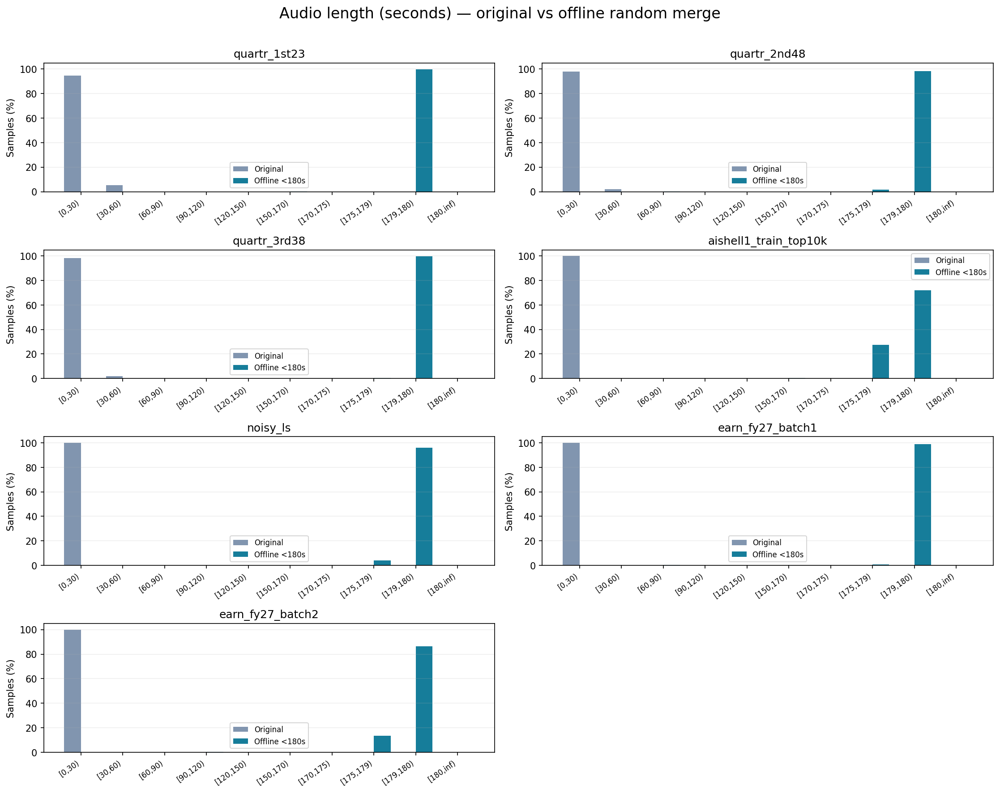
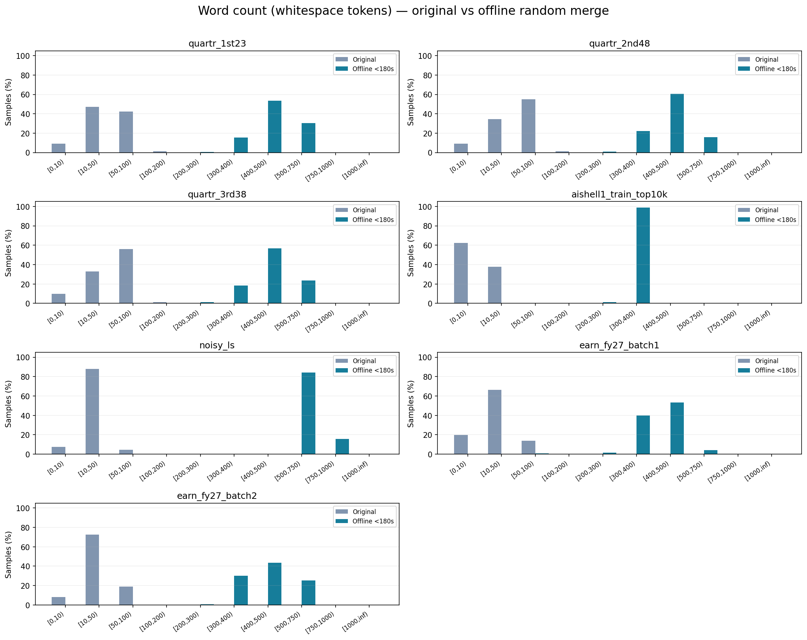

# Base3a SL：逐数据集离线随机拼接至小于三分钟

原始 55,664 条 → 合并后 3,548 条，总音频 177.038 小时。各 dataset 独立处理，EarningsCall 两个 batch 分开输出；每条原始样本恰好使用一次，总时长守恒。

使用最大 100 条候选 buffer，seed=42；随机选择首条，再从 buffer 选择能装入的最长兼容候选，平局随机。严格小于 180 秒，保留所有尾部短样本；没有裁音频、丢弃文本，也没有生成实体拼接音频。

## 数量、时长和词数

| Dataset | 原始条数 | 合并条数 | 总小时 | 原始均长(s) | 合并均长(s) | 合并最短(s) | 合并最长(s) | 原始平均词数 | 合并平均词数 |
|---|---:|---:|---:|---:|---:|---:|---:|---:|---:|
| quartr_1st23 | 3125 | 301 | 15.032 | 17.317 | 179.785 | 150.281 | 180.000 | 44.500 | 462.003 |
| quartr_2nd48 | 6392 | 718 | 35.836 | 20.183 | 179.680 | 75.026 | 180.000 | 49.465 | 440.366 |
| quartr_3rd38 | 6155 | 685 | 34.211 | 20.010 | 179.796 | 136.577 | 180.000 | 50.244 | 451.466 |
| aishell1_train_top10k | 10000 | 257 | 12.803 | 4.609 | 179.347 | 162.879 | 180.000 | 8.769 | 341.214 |
| noisy_ls | 20424 | 930 | 46.406 | 8.180 | 179.635 | 90.673 | 180.000 | 31.223 | 685.704 |
| earn_fy27_batch1 | 4695 | 307 | 15.305 | 11.735 | 179.472 | 78.950 | 179.998 | 26.666 | 407.814 |
| earn_fy27_batch2 | 4873 | 350 | 17.445 | 12.888 | 179.433 | 102.090 | 179.990 | 31.703 | 441.394 |

词数定义为按空白切分的 token 数；AISHELL 中文未做分词，因此它的 word count 不能按中文词汇数量解释，statistics.json 同时给出字符数。

## 输出字段与训练使用

- `audio_path`（及已有音频别名）：按顺序用分号 `;` 拼接，训练加载器读取时自动连接。
- `text` 和保留下来的 display / lexical / ref / hyp 等文本变体：与音频相同顺序，用空格连接；原配方的标签清洗与关键词提取保留。
- `audio_length`：总秒数；已有 `duration` / `audio_duration_seconds` 也更新为总秒数。时长优先采用源清单中的时长，否则读取音频头；两份 EarningsCall 全部由音频头补齐。
- `keywords`：保序去重；`components`：按源顺序展开；`id`：以分号连接。
- 其余字段：保存为与源顺序一致的列表；可空或结构化字段的列表元素用 JSON 编码，具体字段名列在每份 statistics.json 的 `json_encoded_metadata_fields` 中，可逐项 json.loads 恢复。
- `source_metadata_json`：每条原始记录的 JSON 字符串，完整保留原始时间戳、诊断字段和原始参考；`source_audio_lengths` 与 `random_merge_source_indices` 同序。
- 顶层旧 `gt_output` 移除，由训练任务用合并后的 text 重新生成，避免参考文本错位。
- 每个 dataset 的 train_data.yaml 都含完整统计注释；总 train_data.yaml 汇总七份，并禁用重复在线 random_merge。训练入口继承 Base3a SL，仍做 5–30 秒随机分段，mix 使用 epoch:1，避免按旧短句预算重复采样。

样本数减少来自一条新样本包含多条原始短音频。训练的 batch 按合并后的 parent 计数；后续 SL 分段的 segment 数是另一项指标。本次仅准备离线数据和配置，没有提交新训练，也没有变更正在运行的十分钟实验。

## 文件与验证

- Orange 根目录：`az://orngwus2cresco/data/boren/data/verl/offline_random_merge3m_20261114/`。每个 dataset 子目录含 data.jsonl / train_data.yaml / statistics.json。
- [完整统计](statistics.json)、[汇总 CSV](summary.csv)、[总数据 YAML](train_data.yaml)。
- 每份输出均通过全部源索引无重复无遗漏、总时长守恒和完整训练 JSONL/Arrow 加载器回读检查。
- Orange 远端复核：7 份 JSONL 的 SHA-256 全部一致；实际训练加载器完整读取 3,548 条。每份各抽查普通样本和最接近上限样本的音频头时长，与清单一致且小于 180 秒；EarningsCall batch1 实际解码一条 179.88 秒、16 kHz 的合并样本。详见 [验证记录](verification.json)。
- 自动化检查：36 项通过，覆盖分号音频实际读取与波形顺序、严格时长上限、随机可复现、完整来源以及跨 JSON block 的可空元数据。

本环境未挂载 ASR-Research Obsidian vault，详细 note 先保存在本报告；未向不存在的 vault 写入，也未提交 Git。
