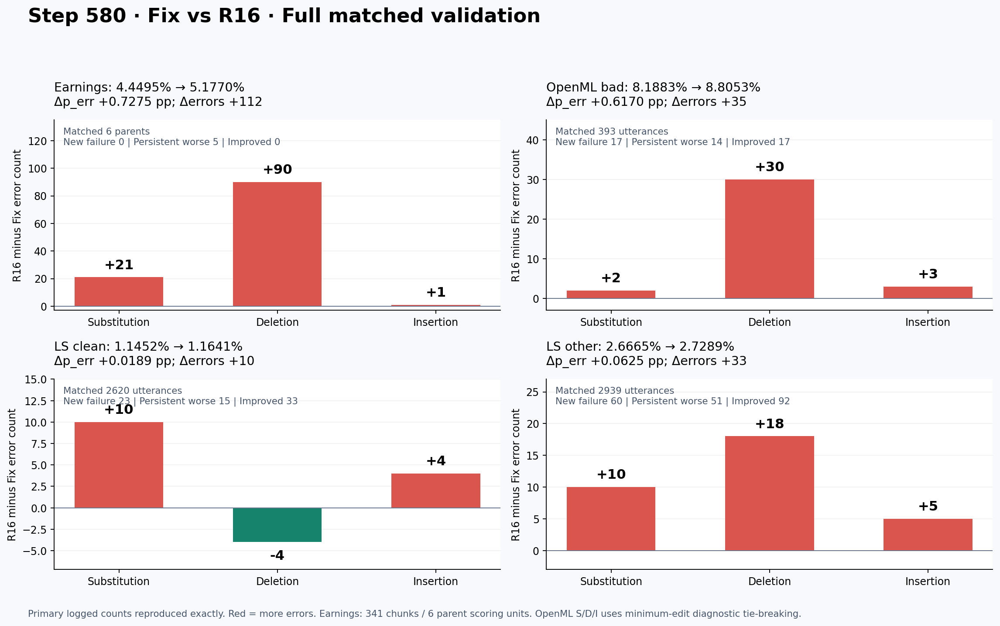

# R16 对 Fix：step 580 完整验证错误分析

R16 在本次同一步验证的四个数据集上均高于 Fix 的错误率，差距主要集中在 Earnings 与 OpenML。Earnings 增加 112 个错误，其中删除增加 90；OpenML 增加 35 个错误，其中删除增加 30。这里使用直接 Fix 基线，未使用历史 unfixed 基线。

数据冻结时间：`2026-10-22T18:15:22.207829+00:00`。rolling 数据最近公共完整验证为 **580**；R16 已有 600，但 Fix 的完整验证截至 580，不能把两者异步的最新点当作同一步比较。

- Fix：`0ca34a537b05e74628264cac2ea86a75`，`baseline_current_after_450`，submission `raysubmit_wUz37YEmnzCbLxpH`。
- R16：`5dc3fdb4c014c9dc1570a5af6e0c1e6e`，`target_current_after_570`，submission `raysubmit_UmggvqWDkrghRcrn`。
- observation fingerprint：`5ff1c2c0449461fc602676edbc7c855f13a21e7bb5baddc3192ac6b3ffcaeccf`。
- 8 份完整 dump 的 SHA 已冻结；所有 **5958 个评分单位**按稳定 ID/parent 配对，0 单边、0 重复、0 参考冲突、0 segment 元数据冲突。全部本地重算的 n_err/n_ref 与日志一致，8 个重建 aggregate 与对应 `val-core/<dataset>/p_err/mean@1` 在 1e-12 内一致。

## 四个数据集分别对比

| 数据集 / 评分单位 | matched | Fix errors/ref | R16 errors/ref | Fix p_err | R16 p_err | Δ pp | Δerrors |
|---|---:|---:|---:|---:|---:|---:|---:|
| earning_chunk_verb / parent_recording | 6 | 685/15395 | 797/15395 | 4.449497% | 5.177006% | +0.727509 | +112 |
| openml_bad / utterance | 393 | 461/5630 | 496/5633 | 8.188277% | 8.805255% | +0.616978 | +35 |
| ls_clean / utterance | 2620 | 607/53004 | 617/53004 | 1.145197% | 1.164063% | +0.018867 | +10 |
| ls_other / utterance | 2939 | 1409/52841 | 1442/52841 | 2.666490% | 2.728942% | +0.062452 | +33 |

所有数据集单独报告，没有跨数据集平均。p_err 是 sum(n_err)/sum(n_ref)，不是逐样本 WER 的均值。Earnings 的 341 chunks 仅构成 6 个 parent；每个 parent 只使用一次非空 group-head counts，null 不按零计。OpenML 有 3 个相同 raw gts 但 n_ref 不同的配对，总分母 5630→5633，来自 hypothesis-dependent compound merge；每侧保留自己的分母。

## 新增失败、持续恶化和改善

新增失败：Fix n_err=0、R16 n_err>0；持续恶化：两边有错且 R16 的 n_err/n_ref 更大；改善：R16 n_err/n_ref 更小；持续不变：相同非零错误率；不变正确：两边零错。比较用整数交叉乘积，避免浮点误判。另存基于原始 n_err 的分类以核对分母敏感样本。

| 数据集 | 新增失败 | 持续恶化 | 改善（其中恢复零错） | 持续不变 | 不变正确 | 新增失败增加错误 | 持续恶化增加错误 | 改善移除错误 |
|---|---:|---:|---:|---:|---:|---:|---:|---:|
| earning_chunk_verb | 0 | 5 | 0 (0) | 1 | 0 | +0 | +112 | 0 |
| openml_bad | 17 | 14 | 17 (3) | 140 | 205 | +36 | +22 | 23 |
| ls_clean | 23 | 15 | 33 (25) | 378 | 2171 | +28 | +18 | 36 |
| ls_other | 60 | 51 | 92 (55) | 741 | 1995 | +70 | +71 | 108 |

| 数据集 | Fix S/D/I | R16 S/D/I | ΔS / ΔD / ΔI |
|---|---:|---:|---:|
| earning_chunk_verb | 333/273/79 | 354/363/80 | +21 / +90 / +1 |
| openml_bad | 311/63/87 | 313/93/90 | +2 / +30 / +3 |
| ls_clean | 490/65/52 | 500/61/56 | +10 / -4 / +4 |
| ls_other | 1175/103/131 | 1185/121/136 | +10 / +18 / +5 |

English 使用部署源码的 `measure_openasr_en_wer` 和 compound-aware kaldialign；OpenML 使用部署源码的语言 normalizer/compound merge，再以 jiwer 得到最小编辑分解。OpenML 等价最小路径可能改变 S/D/I 分配，但本次每条的 S+D+I 与 n_ref 均精确重现日志。S/D/I 是文本对齐结果，不能直接证明声学原因。

## Earnings 六个 parent 的贡献

共享 reference denominator 为 15395。以下 contribution pp 使用每个 parent 的 Δerrors / 15395；可相加得到总体 +0.727509 pp。

| Parent 文件 | chunks | Fix err/ref | R16 err/ref | Δerrors | ΔS/ΔD/ΔI | 对整体 Δpp 的贡献 | 占净增错误 |
|---|---:|---:|---:|---:|---:|---:|---:|
| c6efdf26-e19a-4e33-8bbc-c40283fea3a3.mp3 | 44 | 63/1719 | 106/1719 | +43 | -2/+46/-1 | +0.279311 | 38.39% |
| 647936bd-87b4-4f20-b467-b954263513e6.mp3 | 62 | 143/2647 | 179/2647 | +36 | -4/+40/+0 | +0.233842 | 32.14% |
| 03c13d67-c016-4a2b-91d8-e013d5d6bd2b.mp3 | 66 | 171/3332 | 182/3332 | +11 | +10/-1/+2 | +0.071452 | 9.82% |
| 4468919_trimmed_v2.mp3 | 51 | 80/2128 | 91/2128 | +11 | +7/+4/+0 | +0.071452 | 9.82% |
| e15465c8-dfa8-4483-9051-f65e63f6099b.mp3 | 57 | 219/2688 | 230/2688 | +11 | +11/-1/+1 | +0.071452 | 9.82% |
| 5f02200c-200a-4375-ac6e-de067b353a3f.mp3 | 61 | 9/2881 | 9/2881 | +0 | -1/+2/-1 | +0.000000 | 0.00% |

前两个 parent 合计增加 79 个错误，占 Earnings 净增 112 的 70.54%；二者的删除分别增加 46、40。六个 parent 中 5 个恶化、1 个错误总数不变，没有改善 parent。

Earnings 两边所有 341 行 clean_output 都没有 ASCII `(` 或 `)`；保留括号正文诊断的输入与官方输入完全相同，仍为 Fix 685/15395、R16 797/15395。这里的大幅删除不能用该括号 normalizer 规则解释。

已直接核查主要删除的 raw 正文：c6ef 的 R16 line125/seg11 与 line126/seg12 都只输出 `<src=English.`，clean 为空；对应 Fix 分别包含 “Slower than expected.” 与完整 COVID-19/precautionary measures 句子。647 的 line111/seg59，Fix 有 “In head grade in 2023 ... a stronger performance next year. That is clear ...”；R16 raw 从 `<src=English.\nThat is clear ...` 开始，前半段在原始输出中也没有出现。这些具体位置是未生成正文/部分正文，不能解释成括号归一化删词；是否为声学原因仍需音频或解码证据。

### c6efdf26-e19a-4e33-8bbc-c40283fea3a3.mp3

完整 parent errors：`63/1719 → 106/1719`；以下为 **normalized compound-aware alignment window; all error counts refer to the full parent**，不是 chunk 对完整参考评分。

- Ref："kids center is slower than expected during to covid 19 resurgence we are continuing to closely monitor ongoing covid 19 conditions and proactively taking precautionary measures as our highest priority to ensure the safety and healthy of the children"
- Fix："kids center slower than expected due to covid 19 resurgence we are continuing to closely monitor ongoing covid 19 conditions and proactively taking precautionary measures as our highest priority to ensure the safety and healthy of the children"
- R16："kids center to ensure the safety and healthy of the children"

出处：{"baseline": {"lines": [124, 125, 126, 127], "unmapped_tokens": 0}, "target": {"lines": [124, 127], "unmapped_tokens": 0}}；parent 的完整行号和身份见 analysis.json。

### 647936bd-87b4-4f20-b467-b954263513e6.mp3

完整 parent errors：`143/2647 → 179/2647`；以下为 **normalized compound-aware alignment window; all error counts refer to the full parent**，不是 chunk 对完整参考评分。

- Ref："that remains that remains the case so krasnoyarsk will see a stronger performance next year that is clear thank you very much that is"
- Fix："that remains that remains the case so karstna will see a stronger performance next year that is clear thank you very much that is"
- R16："that is clear thank you very much that is"

出处：{"baseline": {"lines": [111], "unmapped_tokens": 0}, "target": {"lines": [111], "unmapped_tokens": 0}}；parent 的完整行号和身份见 analysis.json。

### 03c13d67-c016-4a2b-91d8-e013d5d6bd2b.mp3

完整 parent errors：`171/3332 → 182/3332`；以下为 **normalized compound-aware alignment window; all error counts refer to the full parent**，不是 chunk 对完整参考评分。

- Ref："phone otherwise please hand back to me darcy thank you we do have a question from paul kaner"
- Fix："phone otherwise please hand back to me darcy thank you we do have a question from paul kaner"
- R16："phone otherwise please hand back to me darcy we do have a question from paul kaner"

出处：{"baseline": {"lines": [272, 273], "unmapped_tokens": 0}, "target": {"lines": [272, 273], "unmapped_tokens": 0}}；parent 的完整行号和身份见 analysis.json。

### 4468919_trimmed_v2.mp3

完整 parent errors：`80/2128 → 91/2128`；以下为 **normalized compound-aware alignment window; all error counts refer to the full parent**，不是 chunk 对完整参考评分。

- Ref："is developing as we go into into 2022 thank you speakers you may have yourself on mute hi"
- Fix："is developing as we go into into 2022 thank you hi"
- R16："is developing as we go into into 2022 hi"

出处：{"baseline": {"lines": [50, 51], "unmapped_tokens": 0}, "target": {"lines": [50, 51], "unmapped_tokens": 0}}；parent 的完整行号和身份见 analysis.json。

### e15465c8-dfa8-4483-9051-f65e63f6099b.mp3

完整 parent errors：`219/2688 → 230/2688`；以下为 **normalized compound-aware alignment window; all error counts refer to the full parent**，不是 chunk 对完整参考评分。

- Ref："segments when it comes to high frequency components it have the profit have declined slightly due to that"
- Fix："segments when it comes to high frequency components it have the profit have declined slightly due to the"
- R16："segments when it comes to high frequency components the profit have declined slightly due to the"

出处：{"baseline": {"lines": [305], "unmapped_tokens": 0}, "target": {"lines": [305], "unmapped_tokens": 0}}；parent 的完整行号和身份见 analysis.json。

### 5f02200c-200a-4375-ac6e-de067b353a3f.mp3

完整 parent errors：`9/2881 → 9/2881`；以下为 **normalized compound-aware alignment window; all error counts refer to the full parent**，不是 chunk 对完整参考评分。

- Ref："s founder chairman and chief executive officer david thank you very much hello and welcome to arqit quantum inc s"
- Fix："s founder chairman and chief executive officer david thank you very much hello and welcome to arqit quantum inc s"
- R16："s founder chairman and chief executive officer david hello and welcome to arqit quantum inc s"

出处：{"baseline": {"lines": [163, 164], "unmapped_tokens": 0}, "target": {"lines": [163, 164], "unmapped_tokens": 0}}；parent 的完整行号和身份见 analysis.json。

## Header 格式与实际文字内容

R16 四个数据集全部 **0 strict2609 header**。这里的严格 header 指合法相邻 `<src=...><tgt=...>` 加换行；缺失 tgt 或缺 `>` 均无法被该 parser 的 2609 分支识别。它说明输出协议退化，不能证明转写正文用了错误语言。

| 数据集 | Fix strict / raw rows | R16 strict / raw rows | R16 closed src only | R16 src 缺闭合角括号 | R16 其他 |
|---|---:|---:|---:|---:|---:|
| earning_chunk_verb | 220/341 | 0/341 | 149 | 181 | 11 |
| openml_bad | 393/393 | 0/393 | 174 | 217 | 2 |
| ls_clean | 2620/2620 | 0/2620 | 176 | 2444 | 0 |
| ls_other | 2936/2939 | 0/2939 | 219 | 2720 | 0 |

所有 raw→clean 均以两次部署 commit SHA 一致的 parser 精确重放：每侧 6293/6293 行一致。大部分非标准头后的正文被 fallback 保留下来；因此不能把 6293 个 header 失败计为 6293 个识别失败。高精度“正文首词粘在 malformed src token 上，被 fallback 清理一起吞掉”的机械 signature 仅 R16 OpenML 2 行，其余数据集为 0；这只是特定 signature 的下界。

| 数据集 | Fix empty clean | R16 empty clean | Fix raw header-only | R16 raw header-only | 非空参考 |
|---|---:|---:|---:|---:|---|
| earning_chunk_verb | 0 | 3 | 0 | 3 | 全部有；Earnings 为完整 parent ref |
| openml_bad | 0 | 1 | 0 | 1 | 全部有；Earnings 为完整 parent ref |
| ls_clean | 0 | 0 | 0 | 0 | 全部有；Earnings 为完整 parent ref |
| ls_other | 0 | 0 | 0 | 0 | 全部有；Earnings 为完整 parent ref |

raw header-only 采用精确元数据规则：raw 去空白后只能等于 `<src=LANGUAGE`、`<src=LANGUAGE.` 或 `<src=LANGUAGE>`，排除可能与正文黏连的其他 token。Earnings 的 3 个 empty clean chunk 全部 raw 也只有 header；OpenML 的 1 个亦然。完整明细另存 `raw_body_diagnostics.json`。

- Earnings ID `54cc0ea6-e633-51ed-b50a-0b805247d274`；parent `647936bd-87b4-4f20-b467-b954263513e6.mp3`；line 95；seg_index 43；音频区间 893.9–905.218 s；raw `<src=English.
`，clean 空；非空完整 parent reference。
- Earnings ID `2b6f28ab-45a2-59fc-b4ba-ff23567dd270`；parent `c6efdf26-e19a-4e33-8bbc-c40283fea3a3.mp3`；line 125；seg_index 11；音频区间 235.6–237.922 s；raw `<src=English.`，clean 空；非空完整 parent reference。
- Earnings ID `48d48dbb-54d5-5efa-bfdc-19b74fa99f2e`；parent `c6efdf26-e19a-4e33-8bbc-c40283fea3a3.mp3`；line 126；seg_index 12；音频区间 237.922–262.7 s；raw `<src=English.`，clean 空；非空完整 parent reference。

- openml_bad ID `15813539945032003892`，line 77：删除的首 token `<src=French.undarban`，其中正文后缀 `.undarban`。官方 8/30；保留该正文后缀的诊断 rescore 8/30。
  - raw："<src=French.undarban sont la plus grande ceinture de mangroves côtières du monde, s'étendant sur 80 km, 50 milles, depuis le côté jusqu'à l'arrière-pays, Bangla, De et India."
  - clean："sont la plus grande ceinture de mangroves côtières du monde, s'étendant sur 80 km, 50 milles, depuis le côté jusqu'à l'arrière-pays, Bangla, De et India."

- openml_bad ID `common_voice_de_19148787`，line 166：删除的首 token `<src=GermanSchuh`，其中正文后缀 `Schuh`。官方 1/4；保留该正文后缀的诊断 rescore 1/4。
  - raw："<src=GermanSchuh hat zwei Kinder."
  - clean："hat zwei Kinder."

## OpenML 括号 normalizer 的敏感性

两模型的 reference 与 hypothesis 采用同一操作：去掉 ASCII `(` 和 `)`，保留括号内所有词，再使用原语言 normalizer/scorer。已核查两侧各 393 个 raw gts，含 `(` 或 `)` 的条数均为 **0**，因此 reference 变换后逐字节不变，现有重算与两侧 reference+hypothesis 同操作严格等价。它是评分敏感性诊断，不覆盖官方验证。

| 范围 | 单位数 | 官方 Δerrors | 保留括号正文后的诊断 Δerrors | 两者差值 |
|---|---:|---:|---:|---:|
| introduced | 4 | +12 | +0 | +12 |
| removed | 2 | -2 | +0 | -2 |
| present_in_both | 2 | +1 | +1 | +0 |

全 OpenML：Fix 官方 461/5630 → 诊断 454/5630；R16 官方 496/5633 → 诊断 479/5632。净增错误从官方 +35 变为诊断 +25，两侧括号评分的差异对应 10 个净错误。官方 p_err 差为 +0.616978 pp，配对诊断差为 +0.441028 pp。分母也略变，不能直接把“10/某个固定分母”当作唯一因果贡献。

### OpenML ID 8031031497862620363

language metadata `Spanish`；Fix/R16 dump line `28/28`；官方 errors `1/45 → 5/45`。

- Ref："Cristina Fernández de Kirchner, quien a la fecha ocupa el cargo de senadora y es la primera dama de la República Argentina, anunció anoche en La Plata, ciudad ubicada a 50 kilómetros 31 millas de Buenos Aires, que se postulará para la presidencia."
- Fix clean："Cristina Fernández de Kirchner, quien a la fecha ocupa el cargo de senadora y es la primera dama de la República Argentina, anunció anoche en La Plata, ciudad ubicada a 50 km, 31 millas, de Buenos Aires, que se postulará para la presidencia."
- R16 clean："Cristina Fernández de Kirchner, quien a la fecha ocupa el cargo de senadora y es la primera dama de la República Argentina, anunció anoche en La Plata, ciudad ubicada a 50 km (31 millas) de Buenos Aires, que se postulará para la presidencia."
- R16 raw："<src=Spanish\n\nCristina Fernández de Kirchner, quien a la fecha ocupa el cargo de senadora y es la primera dama de la República Argentina, anunció anoche en La Plata, ciudad ubicada a 50 km (31 millas) de Buenos Aires, que se postulará para la presidencia."
- R16 normalized："cristina fernández de kirchner quien a la fecha ocupa el cargo de senadora y es la primera dama de la república argentina anunció anoche en la plata ciudad ubicada a cincuenta km de buenos aires que se postulará para la presidencia"

The parenthesized words are present in raw/clean output and removed by the configured normalizer.

### OpenML ID 17411379747303396458

language metadata `Portuguese`；Fix/R16 dump line `122/122`；官方 errors `0/25 → 4/25`。

- Ref："Angel 2006 esclarece a abordagem Continuum como uma metodologia usado para ajudar as organizações a alcançarem níveis mais altos em suas performances."
- Fix clean："Angel, 2006, esclarece a abordagem Continuum como uma metodologia usado para ajudar as organizações a alcançarem níveis mais altos em suas performances."
- R16 clean："Angell (2006) esclarece a abordagem continuum como uma metodologia usado para ajudar as organizações a alcançarem níveis mais altos em suas performances."
- R16 raw："<src=Portuguese\nAngell (2006) esclarece a abordagem continuum como uma metodologia usado para ajudar as organizações a alcançarem níveis mais altos em suas performances."
- R16 normalized："angel esclarece a abordagem continuum como uma metodologia usado para ajudar as organizações a alcançarem níveis mais altos em suas performances"

The parenthesized words are present in raw/clean output and removed by the configured normalizer.

### OpenML ID common_voice_es_19741241

language metadata `Spanish`；Fix/R16 dump line `237/237`；官方 errors `0/8 → 8/8`。

- Ref："Bacterial charity work leads to population-wide resistance."
- Fix clean："Bacterial charity work leads to population-wide resistance."
- R16 clean：""
- R16 raw："<src=Spanish."
- R16 normalized：""

R16 raw contains only a malformed header and no transcription body; empty clean_output is consistent with no generated body, not evidence of a hidden body removed by extraction.

## 其他完整验证样例

### ls_clean

- **newly_failed**：ID `7021-79740-0006`；Fix/R16 line `[1516]/[1516]`；完整 errors `0/15 → 2/15`；S/D/I `0/0/0 → 1/0/1`。
  - Ref："i expect you have been a very good girl andella since you were here last"
  - Fix："I expect you have been a very good girl, Andella, since you were here last."
  - R16："I expect you have been a very good girl, Aunt Ella, since you were here last."

- **newly_failed**：ID `1188-133604-0019`；Fix/R16 line `[233]/[233]`；完整 errors `0/32 → 2/32`；S/D/I `0/0/0 → 1/0/1`。
  - Ref："the large letter contains indeed entirely feeble and ill drawn figures that is merely childish and failing work of an inferior hand it is not characteristic of gothic or any other school"
  - Fix："The large letter contains indeed entirely feeble and ill drawn figures. That is merely childish and failing work of an inferior hand. It is not characteristic of Gothic or any other school."
  - R16："The large letter contains indeed entirely feeble and I'll drawn figures. That is merely childish and failing work of an inferior hand. It is not characteristic of Gothic or any other school."

- **worsening_persistent**：ID `8455-210777-0042`；Fix/R16 line `[1231]/[1231]`；完整 errors `1/11 → 3/11`；S/D/I `1/0/0 → 2/0/1`。
  - Ref："you hear what sir ferdinando brown has said replied captain battleax"
  - Fix："You hear what Sir Fernando Brown has said, replied Captain Battleaxe."
  - R16："You hear what Sir Fernando Brown has said, replied Captain Battle Axe."

- **worsening_persistent**：ID `8555-284447-0023`；Fix/R16 line `[2197]/[2197]`；完整 errors `2/27 → 4/27`；S/D/I `2/0/0 → 3/1/0`。
  - Ref："i couldn't shiver much bein bound so tight but when i'm loose i mean to have jus one good shiver to relieve my feelin's"
  - Fix："I couldn't shiver much, being bound so tight, but when I'm loose I mean to have just one good shiver to relieve my feelin's."
  - R16："I couldn't shiver much being bound so tight, but when I'm loose I mean to have just one good shiver to relieve my feelings."

- **improved**：ID `61-70970-0005`；Fix/R16 line `[357]/[357]`；完整 errors `2/6 → 0/6`；S/D/I `1/1/0 → 0/0/0`。
  - Ref："the lad had checked him then"
  - Fix："The lad ejected him then."
  - R16："The lad had checked him then."

- **improved**：ID `7176-92135-0037`；Fix/R16 line `[2506]/[2506]`；完整 errors `2/11 → 0/11`；S/D/I `1/1/0 → 0/0/0`。
  - Ref："then is the time to introduce a meal on the stage"
  - Fix："Then is the time to introduce Amiel on the stage."
  - R16："Then is the time to introduce a meal on the stage."

### ls_other

- **newly_failed**：ID `8188-269290-0003`；Fix/R16 line `[2218]/[2218]`；完整 errors `0/12 → 3/12`；S/D/I `0/0/0 → 0/2/1`。
  - Ref："every student is to be in east hall at half past eight"
  - Fix："Every student is to be in East Hall at half past eight."
  - R16："Every student is to be in East Hall at 8:30."

- **newly_failed**：ID `7018-75789-0016`；Fix/R16 line `[120]/[120]`；完整 errors `0/22 → 3/22`；S/D/I `0/0/0 → 1/0/2`。
  - Ref："then i took leave of him and of all my intimates and acquaintances in the island and embarked with the merchants aforesaid"
  - Fix："Then I took leave of him and of all my intimates and acquaintances in the island, and embarked with the merchants afore said."
  - R16："Then I took leave of him and of all my intimates and acquaintances in the island, and embarked with the merchants I fore said."

- **worsening_persistent**：ID `2609-156975-0016`；Fix/R16 line `[398]/[398]`；完整 errors `6/8 → 12/8`；S/D/I `3/0/3 → 7/0/5`。
  - Ref："was moses justified in resisting the egyptian taskmaster"
  - Fix："Which mores it's justified in resisting the Egyptian tax, Master?"
  - R16："Which mo's it's just findin' resists in the gipsy tax, master?"

- **worsening_persistent**：ID `2609-157645-0008`；Fix/R16 line `[297]/[297]`；完整 errors `1/8 → 4/8`；S/D/I `1/0/0 → 3/0/1`。
  - Ref："let them sing another psalm said the curate"
  - Fix："Them them sing another psalm, said the curate."
  - R16："Them them sing an oth' psalms, said the curate."

- **improved**：ID `7902-96595-0017`；Fix/R16 line `[359]/[359]`；完整 errors `4/11 → 1/11`；S/D/I `1/1/2 → 0/1/0`。
  - Ref："i dunno muttered dick and a man can't be sure"
  - Fix："I don't know, muttered Dick. A man can't be sure."
  - R16："I dunno, muttered Dick. A man can't be sure."

- **improved**：ID `2609-169640-0000`；Fix/R16 line `[381]/[381]`；完整 errors `7/32 → 4/32`；S/D/I `5/1/1 → 3/0/1`。
  - Ref："proas in that quarter were usually distrusted by ships it is true but the sea is full of them and far more are innocent than are guilty of any acts of violence"
  - Fix："Parrots in that quarter were usually distrusted by the sepsa, it is true, but the see us for them, and far more are innocent than are guilty of any acts of violence."
  - R16："Parrots in that quarter were usually distrusted by the sepsa, it is true, but the see is full of them, and far more are innocent than are guilty of any acts of violence."

## 解释边界与可复核产物

这份结果说明 step580 时 R16 的完整验证转写与协议表现；同一步并不等于同 fresh-data exposure。R16 当前 replay16/fresh112/buffer400，首 50 次继承更新采用过 replay12/fresh116 和 ReplayLossNormalizer；Fix fresh128。恢复会重置 replay buffer，输入重建也未完整固定随机状态。因此这组观察不能单独确证 replay 的因果效果，也不是干净的 replay-only 单因素消融。

本分析不改变任何训练状态或原始来源。`analysis.json` 含总体、全部 parent、header、括号诊断及 reviewed cases；`matched_units_step580.jsonl` 含 5958 个逐单位的配对、S/D/I、分类、行号与参考哈希；`source_manifest.json` 与 `source_snapshot/` 提供文件 SHA 和冻结来源；`scorer_snapshot/` 保留两次实际部署的 scorer/normalizer；`latest_common_step_evidence.json` 固定为何选择 580。

