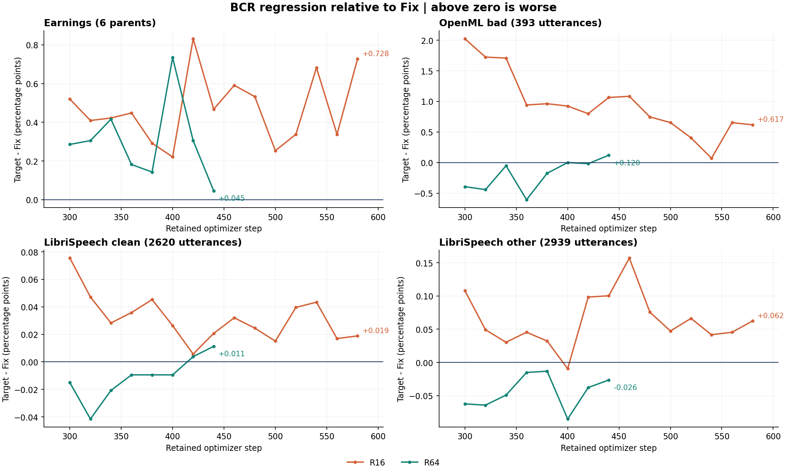

# BCR 结果、机制与错误案例分析

R16 的持续退化比较明确，主要表现为正文缺失和漏词；R64 的结果包含数据集取舍，近期 OpenML 收益回吐，且其很小的 OpenML 差距有明显评分风格成分。现有证据不足以把二者概括为“replay越多越差”，也没有隔离出BCR本身的因果效果。

这份报告使用固定切片：R16/Fix的保留模型轨迹来自2026-10-22 10:34–10:36 PDT的采集，R64最新完整训练来源截至10:49 PDT。完整文本在本轮重新获取/冻结。它不是当前所有job仍在运行的声明；较晚的只读Ray观察单独保存在details/mechanism/live_observation.json。

**比较对象与证据范围**

| 标签 | 精确实验 | W&B run |
|---|---|---|
| Fix | `remax_dev_base0_v1h2a_fix` | [0ca34a537b05e74628264cac2ea86a75](https://msaip.wandb.io/genai/v2611/runs/0ca34a537b05e74628264cac2ea86a75) |
| R16 | `remax_dev_base0_v1h2a_fix_bcr` | [5dc3fdb4c014c9dc1570a5af6e0c1e6e](https://msaip.wandb.io/genai/v2611/runs/5dc3fdb4c014c9dc1570a5af6e0c1e6e) |
| R64 | `remax_dev_base0_v1h2a_fix_bcr64` | [e51cc81ed31e918470dbcc8143a6b731](https://msaip.wandb.io/genai/v2611/runs/e51cc81ed31e918470dbcc8143a6b731) |

基线是直接Fix配置。每对完整配对5958个评分单位：6个Earnings parent录音（341 chunks）、393条OpenML、2620条LS clean、2939条LS other。零单边样本、零原始reference冲突。Earnings只取一次parent group-head counts，未把341 chunks当成341个独立长录音。

R16和R64各自都有真实`val/generations`表，step580/440各20条，并已通过完整dump补齐对侧；这些表是选择样本，全量统计全部使用完整验证集。R64原始391–396步已回滚，分析使用原始≤390与当前recovery391+；R16/Fix的回滚支线也已排除。

**最新共同步数：官方p_err**

| 数据集 | Fix@580 → R16@580 | Δ pp / Δerrors | Fix@440 → R64@440 | Δ pp / Δerrors |
|---|---:|---:|---:|---:|
| earning_chunk_verb | 4.4495% → 5.1770% | +0.7275 / +112 | 4.4950% → 4.5404% | +0.0455 / +7 |
| openml_bad | 8.1883% → 8.8053% | +0.6170 / +35 | 8.4547% → 8.5745% | +0.1198 / +7 |
| ls_clean | 1.1452% → 1.1641% | +0.0189 / +10 | 1.1527% → 1.1641% | +0.0113 / +6 |
| ls_other | 2.6665% → 2.7289% | +0.0625 / +33 | 2.6930% → 2.6665% | -0.0265 / -14 |

数值越低越好，pp为百分点。OpenML有hypothesis-dependent compound归一化，Fix/R16@580分母5630/5633，Fix/R64@440同为5630/5633；不能用target分母去计算baseline。所有官方比率均独立从各自logged counts重建到1e-12内。

从step80开始的26个共同检查，R16的Earnings、OpenML、LS clean每次都差于Fix；LS other有22次差、4次好。R64在step80–440的19次检查中，Earnings每次都差；OpenML16次好、2次差、1次持平；LS clean12次好、7次差；LS other14次好、4次差、1次持平。R64的OpenML在step300达到8.2017%，到440回升至8.5745%，同时Fix到440下降至8.4547%，所以部分现象是早期收益回吐和基线追上。

**错误类型：主要增加了什么**

| 比较 | 数据集 | 新增失败 / 持续恶化 / 改善 | Δ替换 / Δ删除 / Δ插入 |
|---|---|---:|---:|
| R16@580 | earning_chunk_verb | 0 / 5 / 0 | +21 / +90 / +1 |
| R16@580 | openml_bad | 17 / 14 / 17 | +2 / +30 / +3 |
| R16@580 | ls_clean | 23 / 15 / 33 | +10 / -4 / +4 |
| R16@580 | ls_other | 60 / 51 / 92 | +10 / +18 / +5 |
| R64@440 | earning_chunk_verb | 0 / 2 / 4 | +21 / -8 / -6 |
| R64@440 | openml_bad | 16 / 11 / 20 | +4 / +10 / -7 |
| R64@440 | ls_clean | 23 / 15 / 31 | +11 / -3 / -2 |
| R64@440 | ls_other | 41 / 31 / 85 | -8 / +5 / -11 |

新增失败要求Fix零错而target非零；持续恶化要求两者都有错且target错误率更高。改善包含恢复零错。持平和保持正确也全部保存在逐条数据中。S/D/I为同scorer重现后的文本编辑分解，不直接证明声学原因。

**R16：可直接看到的正文缺失**

Earnings净增112个错误中，删除增加90、替换增加21、插入增加1。六个parent分别净增43、36、11、11、11、0，前两段占70.54%；5段恶化、1段持平，没有改善段。两侧所有Earnings clean_output和full-parent参考均无ASCII括号，所以下述大幅漏词不能由该括号规则解释。

1. `c6efdf26-e19a-4e33-8bbc-c40283fea3a3.mp3`，完整parent errors为63→106。对齐参考/Fix含“slower than expected … COVID-19 resurgence … continuing to closely monitor … proactively taking precautionary measures as our highest priority”，R16直接接到“to ensure the safety …”。原始dump的seg11、12（JSONL行125、126）都只有`<src=English.`，没有正文。不是cleaner把已经生成的COVID句子删掉。

2. `647936bd-87b4-4f20-b467-b954263513e6.mp3`，完整parent errors为143→179。seg59（行111）的参考/Fix包含“that remains … a stronger performance next year. That is clear …”，R16 raw从“That is clear. Thank you very much …”开始，前半段未生成。此parent另有seg43（行95）只生成header。

3. OpenML `common_voice_es_19741241`，行237：reference和Fix都是“Bacterial charity work leads to population-wide resistance.”；R16 raw只有`<src=Spanish.`，clean为空，错误0→8。原数据language字段为Spanish而参考为英语，这里只陈述原始数据与输出，不在未听音频时断言标签或声学质量。

4. LS clean `1221-135767-0016`：reference/Fix的“gentlemen of fair estate”变为R16的“gentlemen of fairer state”，错误0→2；LS other `2609-156975-0016`的“was Moses justified … Egyptian taskmaster”在Fix已难（6错），R16进一步成为“which mo's it's just findin' … gipsy tax, master”（12错），属于持续困难恶化。

R16共3个Earnings chunk和1个OpenML样本clean为空，raw均为header-only；Fix相应empty为0。LS clean/other均无整条空正文；LS clean主要增加替换，LS other仍以删除增加最多，属于非整条空输出的局部识别差异。

**R64：小差距、评分风格和改善反例**

1. LS clean `7176-92135-0037`，参考/Fix：“then is the time to introduce **a meal** on the stage”；R64：“… introduce **Amiel** …”，官方错误0→2。`8555-284447-0006`的“snub-nosed princesses”→“snow-nosed princesses”，同样0→2。这是同音/词形消歧的实际局部退化。

2. OpenML `8031031497862620363`：reference有“50 kilómetros 31 millas”，Fix为“50 km, 31 millas”，R16@580和R64@440都写“50 km (31 millas)”。两对官方错误均1→5，但括号中的正文并没有漏生成；normalizer会移除括号内容。另有`16940047964722835471`的“(50 millas)”与`9071737899953350186`的“(FTIR)”造成类似敏感性。

3. 反例：LS other `8188-269290-0003`，参考：“every student is to be in east hall at **half past eight**”；Fix写“at **8:30**”（官方3错），R64保留“half past eight”（0错）。这是归一化/表达约定也影响改善的例子。另一条`2609-169640-0000`中Fix的“see us for them”被R64改成“sea is full of them”，错误7→3，虽仍有“proas”等持续错误。R64在LS other有85条改善，41条新增失败、31条持续恶化，净减少14错。

对两侧reference+hypothesis统一只移除ASCII括号符号、保留其中正文，并使用相同scorer：R16的OpenML官方差距+35错变为诊断+25（Fix461→454；R16496→479）；R64官方+7变为诊断+2（Fix476→464；R64483→466）。393个参考本身均无ASCII括号。这个反事实仅说明10个/5个净差对括号约定敏感，不替代官方p_err，也不证明其余错误全是声学问题。

**机制证据与归因边界**

| @440 保留轨迹 | Fix | R16 | R64 |
|---|---:|---:|---:|
| fresh prompt presentations | 56,320 | 49,480 | 28,160 |
| replay presentations | 0 | 6,780 | 28,032 |
| 原始prompt presentations | 56,320 | 56,260 | 56,192 |

R16@580 fresh65,160/replay9,004，Fix fresh74,240。重放替代了新样本，同step不是同fresh曝光；这些presentation也不是独立音频数。R64早期OpenML仍曾有收益，所以曝光稀释不是单独充分的解释。独立音频曝光量和精确wall/GPU预算本次未完整重建，不能宣称完成等数据或等成本因果实验。

R16在step580的6293个验证raw行中没有完整2609 src/tgt头，Fix绝大多数合规。部署SHA一致的parser重放逐行复现clean_output：缺tgt时lang得0，fallback仍可保留正文。训练224–609的386步，raw lang和d_lang的min/max/mean均0；401–440的v_lang也全0。已确认该窗口语言分量没有差分奖惩；训练raw header形态没有完整dump，不能把验证header形态逐条外推到训练。若sampled恢复合法tgt而greedy仍失败，语言分量仍可贡献+0.125，故不称不可恢复死锁。

困难池以greedy raw word低分排名，当前策略重新生成，不是缓存旧response做离线训练。全局低分池没有source quota、TTL、cooldown或max-use，buffer也不随checkpoint保存。401–440重放后重新进入低分池的比例：R16为579/624=92.79%，R64为2314/2560=90.39%。这表示这些重放输入大多仍留在低分集合，不等于同一个样本被无限复用，也不证明脏样本垄断。没有buffer的来源/使用次数/年龄分布，过度集中仍是假设。`replay/score_mean`是当前整批fresh+replay的greedy分数，不能当成buffer均值。

| 共同训练401–440，40步均值 | Fix | R16 | R64 |
|---|---:|---:|---:|
| raw sampled word | 0.904409 | 0.829178 | 0.892065 |
| 最终relative reward | -0.005900 | -0.003827 | -0.006282 |
| raw parsed tag lang | 0.938916 | 0.000000 | 0.954932 |
| actor KL loss | 0.032995 | 0.086654 | 0.029013 |

word/word_del/word_ins/word_kw/lang五个component的core、delta、vote三族均已尝试并覆盖，完整inventory和40步窗口统计见scalar_analysis.json及reward_window.csv。现代三者reward/scorer相关固定源码SHA一致，配方为`(v_word + .1*v_word_del + .1*v_word_ins + .2*v_word_kw + .2*v_lang)/1.6`，component先clip到±10。R16的相对reward更高同时raw word更低，说明sampled相对greedy的差分与绝对转写质量不同；混合训练batch也不是固定验证集。较高KL与行为漂移一致，但不足以单独证明过拟合。

R16的前50步使用replay12和ReplayLossNormalizer，51步后改replay16和原actor loss；R64为replay64、capacity1280，R16 capacity400。加上重启和buffer重建，现有两条轨迹不能隔离replay数量、容量、早期loss和恢复行为。当前checkout不含这批BCR实现，因此机制结论以部署固定Git blob为准，未用当前HEAD泛推旧job。

**下一轮优先做的可检验比较**

1. 固定同一代码、初始化、original actor loss、解码/scorer与data mix，从头比较off / all-seen uniform reservoir replay / hard pool。后两者先统一replay16、capacity400。uniform与hard有相同fresh/replay配额，可以直接检验“全局挑最难”是否有额外收益或损害。

2. 同时画固定step、累计fresh presentations两套横轴，并记录rollout/audio处理量、wall/GPU时间。为隔离格式漂移，记录每批sampled/greedy头合法率、lang得分以及empty/header-only比例；任何格式约束或格式anchor都应作为单独ablation，不能只凭lang低就盲目加权。

3. 输出buffer的source、稳定ID、greedy word、入池年龄与使用次数。如果确实集中于不可学样本，再分别试source quota或max-use/TTL；先取证再改一个因素。成功标准是相同预算下Earnings/OpenML官方p_err和header-only/漏词减少，同时LS clean/other不恶化。

4. 单独审核括号归一化约定；所有模型和reference采用同一规则复评并保留旧官方指标。训练比较和scorer变更应分开，避免把显示格式变化解释成声学识别进步。

本轮没有修改配置或启动训练。尚无多seed复现与音频听审；对噪声/标签错误、样本不可学、来源垄断和声学机制的说法仍属待验证假设。

**初始、最新与最佳观测：各数据集独立**

| 数据集 | Run | 初始 % @step | 最新 % @step | 最佳 % @step |
|---|---|---:|---:|---:|
| earning_chunk_verb | Fix | 4.8392 @0 | 4.4495 @580 | 4.2222 @80 |
| earning_chunk_verb | R16 | 4.8392 @0 | 5.0796 @600 | 4.3651 @100 |
| earning_chunk_verb | R64 | 4.8392 @0 | 4.5404 @440 | 4.3910 @120 |
| openml_bad | Fix | 15.0080 @0 | 8.1883 @580 | 8.1883 @580 |
| openml_bad | R16 | 15.0080 @0 | 8.5567 @600 | 8.5567 @600 |
| openml_bad | R64 | 15.0080 @0 | 8.5745 @440 | 8.2017 @300 |
| ls_clean | Fix | 1.2622 @0 | 1.1452 @580 | 1.1320 @540 |
| ls_clean | R16 | 1.2622 @0 | 1.1735 @600 | 1.1641 @580 |
| ls_clean | R64 | 1.2622 @0 | 1.1641 @440 | 1.1169 @320 |
| ls_other | Fix | 2.7270 @0 | 2.6665 @580 | 2.6665 @580 |
| ls_other | R16 | 2.7270 @0 | 2.7308 @600 | 2.7043 @140 |
| ls_other | R64 | 2.7270 @0 | 2.6665 @440 | 2.6608 @260 |

最佳点是每数据集的描述性最小值，不是一个同时获得全部最优值的checkpoint。不同run的最新点和验证机会数不同，不能把这张表当作同预算排名。

**交付与验证**

- [可搜索完整案例图表](index.html)：11916个配对记录，默认显示退化，也可看改善反例。
- [机器可读总证据](evidence.json)、[全部案例](case_data.json)、[16份原始dump的SHA清单](sources/dump_manifest.json)。
- [R16详细报告](details/r16/report.md)、[R64详细报告](details/r64/report.md)、[机制报告](details/mechanism/mechanism_analysis.md)。
- [验证结果](validation_checks.json)：50项source hash、完整ID覆盖、16个官方aggregate与前端过滤逻辑检查通过；前端检查使用Node VM DOM mocks，不是实际浏览器渲染测试。PNG图已人工查看。
