# Validation / Reward 实验对比

报告生成：2026-10-22T17:19:08.678546+00:00。运行状态来自实时 Ray，图表按相关实验分组。

[打开离线交互图表](index.html) · [完整PDF](comparison_charts.pdf) · [状态](status.md) · [样例审计](examples_audit.md) · [证据](evidence.json)

## 实验与来源

| 组 | 实验 | Ray状态 | W&B状态 | 曲线最新训练step | 曲线来源时间 |
|---|---|---|---|---:|---|
| dev | [Historical v1h2a](https://msaip.wandb.io/genai/v2611/runs/bee227f074fb5352265059c051944c2a) | NOT_OBSERVED_RUNNING | crashed | 479 | 2026-10-22T17:12:41.062542+00:00 |
| dev | [Fix](https://msaip.wandb.io/genai/v2611/runs/0ca34a537b05e74628264cac2ea86a75) | RUNNING | running | 569 | 2026-10-22T17:11:50.256294+00:00 |
| dev | [L0](https://msaip.wandb.io/genai/v2611/runs/0d485800242bfc5784c5bd4a88f8d102) | RUNNING | running | 504 | 2026-10-22T17:11:49.926441+00:00 |
| dev | [L1](https://msaip.wandb.io/genai/v2611/runs/f42206aacf1f9a861601f4078737ad08) | NOT_OBSERVED_RUNNING | crashed | 340 | 2026-10-22T15:24:05.968552+00:00 |
| dev | [L2](https://msaip.wandb.io/genai/v2611/runs/06a732c00714070c46b72a90837f6121) | NOT_OBSERVED_RUNNING | crashed | 346 | 2026-10-22T17:12:34.848146+00:00 |
| dev | [Replay16](https://msaip.wandb.io/genai/v2611/runs/5dc3fdb4c014c9dc1570a5af6e0c1e6e) | RUNNING | running | 593 | 2026-10-22T17:11:50.144814+00:00 |
| dev | [Replay64](https://msaip.wandb.io/genai/v2611/runs/e51cc81ed31e918470dbcc8143a6b731) | RUNNING | running | 429 | 2026-10-22T17:11:50.209366+00:00 |
| hindi | [Hindi v0](https://msaip.wandb.io/genai/v2611/runs/7fd617c24690b4b598ad9ae15113156f) | NOT_OBSERVED_RUNNING | crashed | 701 | 2026-10-22T17:12:39.699323+00:00 |
| hindi | [Hindi v1](https://msaip.wandb.io/genai/v2611/runs/d9f3c96e5073da21a91680a234a6453f) | RUNNING | running | 660 | 2026-10-22T17:11:49.763816+00:00 |

## Dev validation

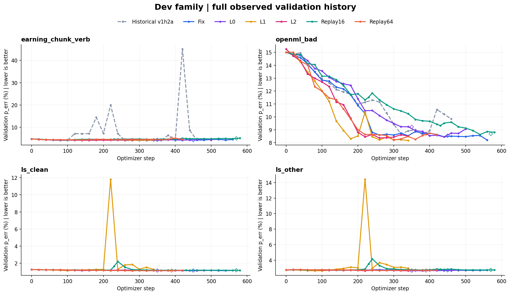

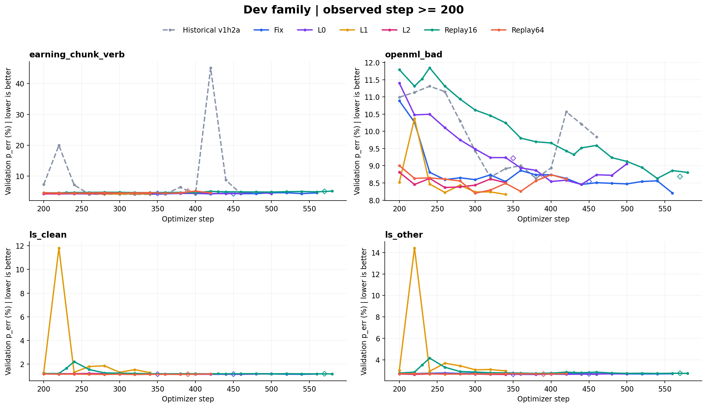

| 数据集 | Run | 共同step | p_err % | 相对参考 pp |
|---|---|---:|---:|---:|
| earning_chunk_verb | Historical v1h2a | 340 | 4.150698 | -0.110425 |
| earning_chunk_verb | Fix | 340 | 4.261124 | +0.000000 |
| earning_chunk_verb | L0 | 340 | 4.423514 | +0.162390 |
| earning_chunk_verb | L1 | 340 | 4.293602 | +0.032478 |
| earning_chunk_verb | L2 | 340 | 4.533940 | +0.272816 |
| earning_chunk_verb | Replay16 | 340 | 4.683339 | +0.422215 |
| earning_chunk_verb | Replay64 | 340 | 4.676843 | +0.415719 |
| ls_clean | Historical v1h2a | 340 | 1.177270 | +0.024526 |
| ls_clean | Fix | 340 | 1.152743 | +0.000000 |
| ls_clean | L0 | 340 | 1.141423 | -0.011320 |
| ls_clean | L1 | 340 | 1.271602 | +0.118859 |
| ls_clean | L2 | 340 | 1.152743 | +0.000000 |
| ls_clean | Replay16 | 340 | 1.181043 | +0.028300 |
| ls_clean | Replay64 | 340 | 1.131990 | -0.020753 |
| ls_other | Historical v1h2a | 340 | 2.704339 | -0.047312 |
| ls_other | Fix | 340 | 2.751651 | +0.000000 |
| ls_other | L0 | 340 | 2.651350 | -0.100301 |
| ls_other | L1 | 340 | 2.959823 | +0.208172 |
| ls_other | L2 | 340 | 2.626748 | -0.124903 |
| ls_other | Replay16 | 340 | 2.781931 | +0.030280 |
| ls_other | Replay64 | 340 | 2.702447 | -0.049204 |
| openml_bad | Historical v1h2a | 340 | 8.914935 | +0.375968 |
| openml_bad | Fix | 340 | 8.538967 | +0.000000 |
| openml_bad | L0 | 340 | 9.236234 | +0.697268 |
| openml_bad | L1 | 340 | 8.167614 | -0.371353 |
| openml_bad | L2 | 340 | 8.507993 | -0.030974 |
| openml_bad | Replay16 | 340 | 10.246848 | +1.707881 |
| openml_bad | Replay64 | 340 | 8.487216 | -0.051751 |

共同step只使用全组都实际有记录的点。详细 initial/latest/best 与 pairwise 最新共同step见交互图表及 CSV。

## Dev reward

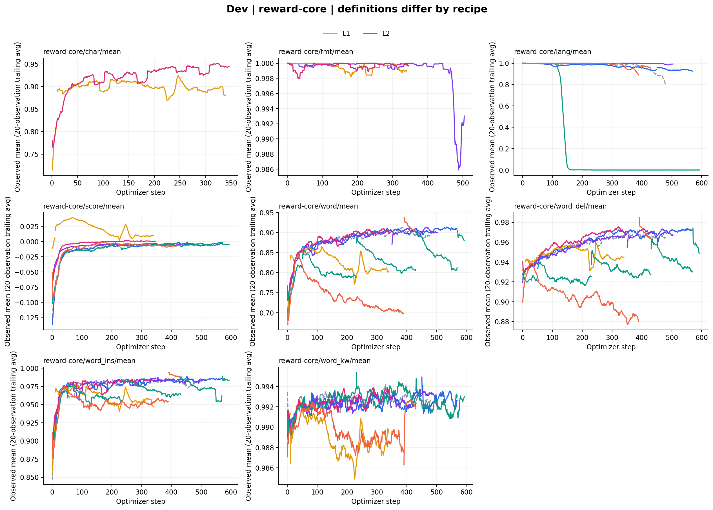

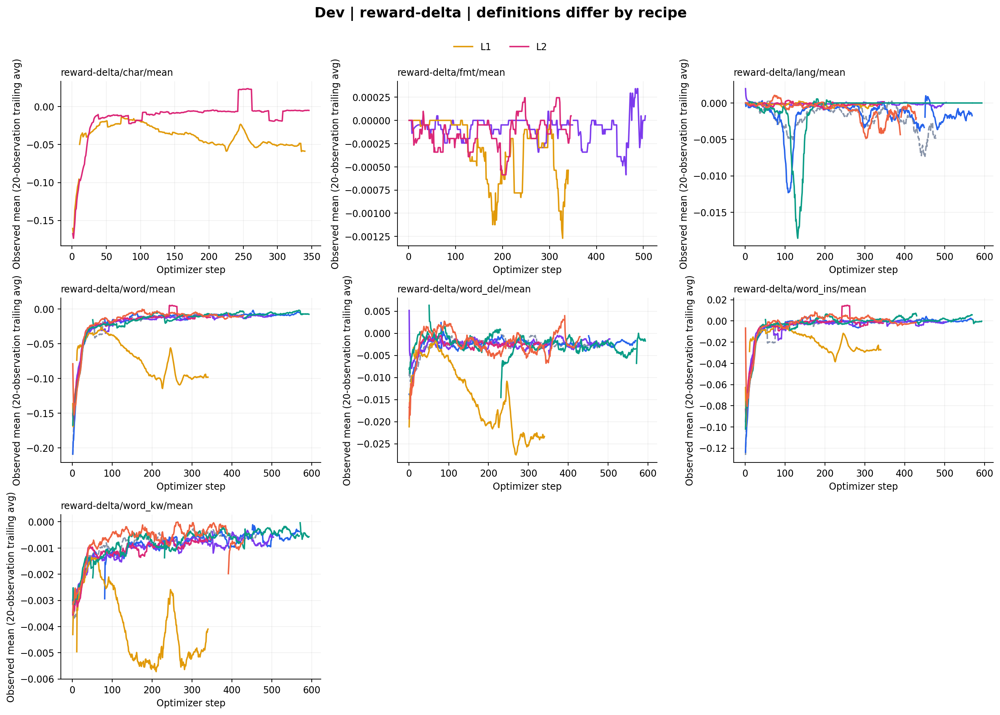

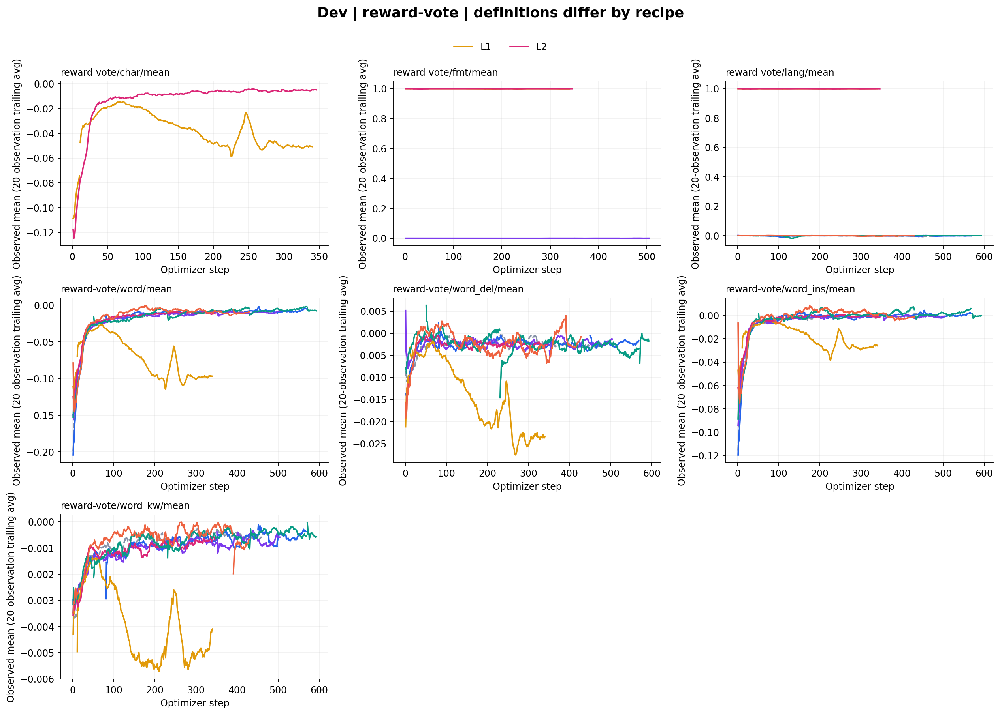

## Hindi validation

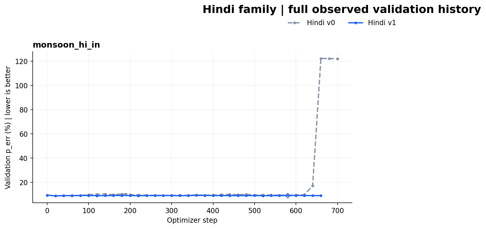

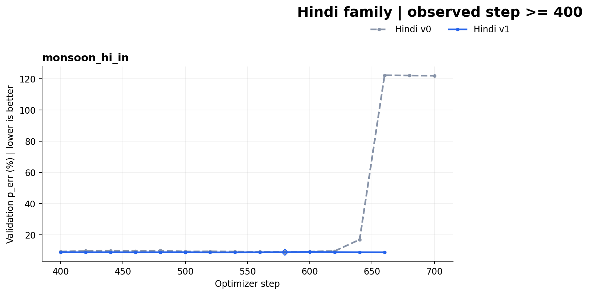

| 数据集 | Run | 共同step | p_err % | 相对参考 pp |
|---|---|---:|---:|---:|
| monsoon_hi_in | Hindi v0 | 660 | 122.298343 | +0.000000 |
| monsoon_hi_in | Hindi v1 | 660 | 8.915042 | -113.383300 |

共同step只使用全组都实际有记录的点。详细 initial/latest/best 与 pairwise 最新共同step见交互图表及 CSV。

## Hindi reward

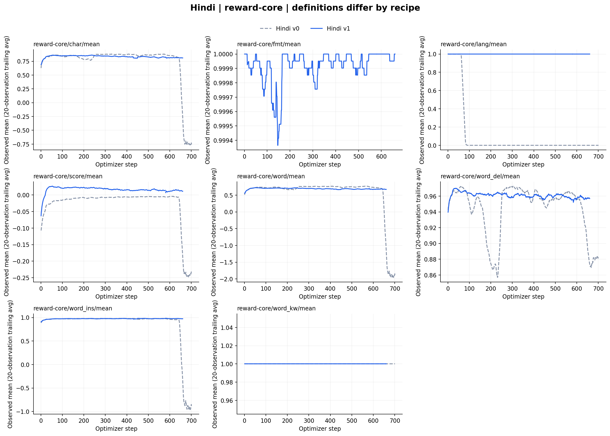

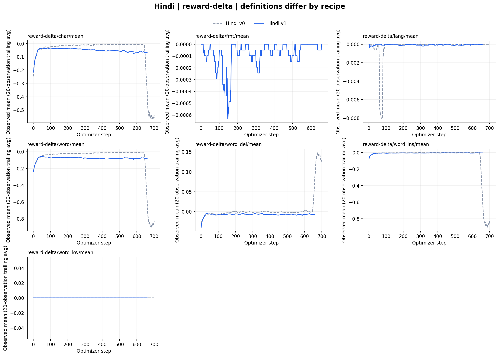

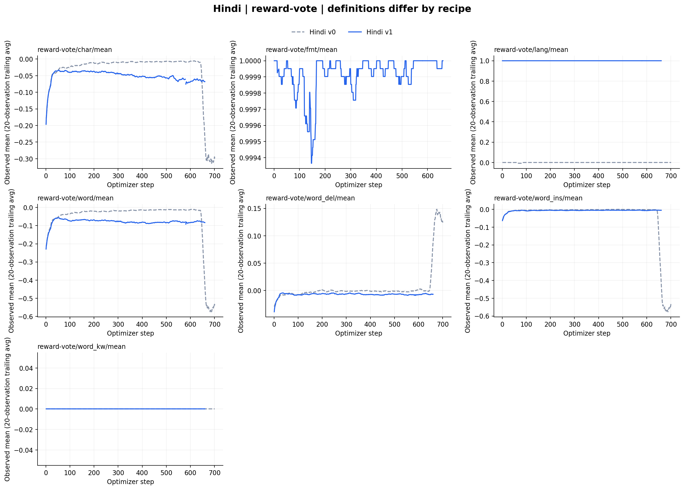

## 运行中 Dev 最近对比

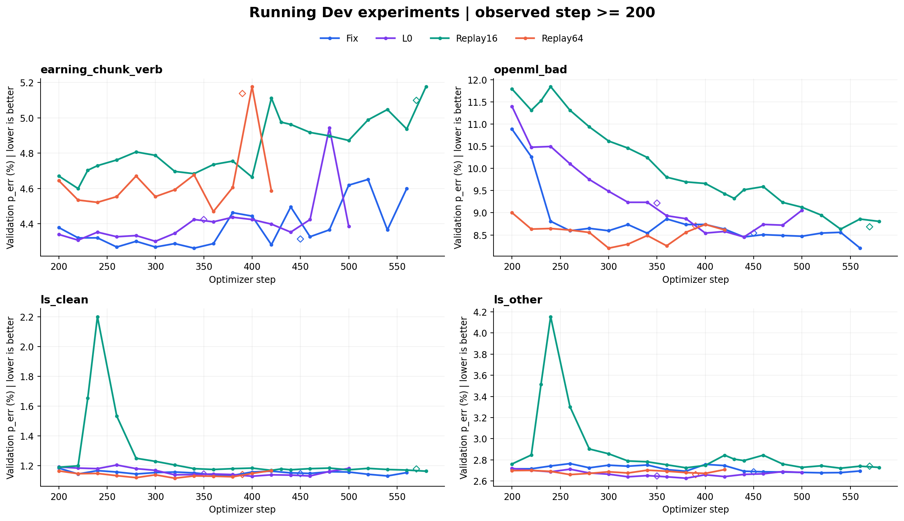

| 数据集 | Run | 共同step | p_err % | 相对Fix pp |
|---|---|---:|---:|---:|
| earning_chunk_verb | Fix | 420 | 4.280611 | +0.000000 |
| earning_chunk_verb | L0 | 420 | 4.397532 | +0.116921 |
| earning_chunk_verb | Replay16 | 420 | 5.112049 | +0.831439 |
| earning_chunk_verb | Replay64 | 420 | 4.585905 | +0.305294 |
| ls_clean | Fix | 420 | 1.164063 | +0.000000 |
| ls_clean | L0 | 420 | 1.139537 | -0.024526 |
| ls_clean | Replay16 | 420 | 1.169723 | +0.005660 |
| ls_clean | Replay64 | 420 | 1.167836 | +0.003773 |
| ls_other | Fix | 420 | 2.745974 | +0.000000 |
| ls_other | L0 | 420 | 2.641888 | -0.104086 |
| ls_other | Replay16 | 420 | 2.844382 | +0.098408 |
| ls_other | Replay64 | 420 | 2.708124 | -0.037849 |
| openml_bad | Fix | 420 | 8.630794 | +0.000000 |
| openml_bad | L0 | 420 | 8.579041 | -0.051753 |
| openml_bad | Replay16 | 420 | 9.429941 | +0.799148 |
| openml_bad | Replay64 | 420 | 8.613035 | -0.017759 |

## 比较限制

- Validation 使用 exact val-core/val-aux/<dataset>/p_err/mean@1，显示为 100 × fraction，越低越好；不同数据集分别报告，不求跨集平均。
- 当前运行状态来自实时 Ray；曲线同时含实时 W&B 与已验证的 driver 历史，各来源时间单独列出。快照不是原子采集。
- 同一步数对比只使用双方真实观测，不插值、不前向填充。各自 latest/best 对应不同预算；每个数据集的 best 不能拼成一个 checkpoint。
- Dev reward 配方不同：Fix divisor1.6；L0 divisor3；L1/L2 divisor4 且 lang/fmt 含 absolute 项。scalar score 和 lang/fmt 不可直接作为跨配方排名；原始分量也受训练 batch 组成影响。
- Replay16 初始50步曾用 replay12 和 ReplayLossNormalizer；之后 replay16/capacity400。Replay64 为64/capacity1280。同 optimizer step 的 fresh 数据量、buffer 和历史 loss 都不同。
- 恢复回退的旧分支不进入主线；恢复时 validation 单独用菱形标记。部分缺失历史或未保存尾部不能补造，总历史曝光量可能未知。
- 历史 v1h2a 保留官方 Earnings 高错误点。已有旧 step 的 malformed-tag 证据不能解释未审计的新峰值。
- reward 曲线显示20个已观测点的尾随均值，仅在同一记录段内计算；可切换原始值。缺失 metric 为 N/A，不补0。
- L1 的11–340训练记录使用已绑定恢复job的存档driver，W&B旧分支11–15被替换；未checkpoint341–347仅保留在证据。L2为中断的首次attempt历史，不代表已恢复。
- 样例审计来自存档对应 step；当前新 step 未取得配对文本时，不用旧样例推断新变化原因。

## 样例与下一步

样例覆盖与配置审核见 [examples_audit.md](examples_audit.md)。先按同step核对每个数据集的得失；对于最新曲线峰值，下一步应取同step完整配对 dump 核对模型输出和 scorer，再决定配方调整。已有存档样例不能证明新step变化的原因。

同step冲突/轴异常共 0 条，原始记录完整保留于 evidence.json；冲突的同step指标不进入匹配统计。

## Initial / latest / best 明细

数值单位为百分比，各自对应实际 step。initial 是首次可见观测，恢复后首次验证不能当作未训练初始模型。

### Dev

| 数据集 | 实验 | 首次观测 | 最新观测 | 最好观测 |
|---|---|---|---|---|
| earning_chunk_verb | Historical v1h2a | 4.839234% @0 | 4.293602% @460 | 4.124716% @320 |
| earning_chunk_verb | Fix | 4.839234% @0 | 4.598896% @560 | 4.222150% @80 |
| earning_chunk_verb | L0 | 4.839234% @0 | 4.384540% @500 | 4.228646% @140 |
| earning_chunk_verb | L1 | 4.839234% @0 | 4.293602% @340 | 4.274115% @280 |
| earning_chunk_verb | L2 | 4.865216% @0 | 4.533940% @340 | 4.248133% @160 |
| earning_chunk_verb | Replay16 | 4.839234% @0 | 5.177006% @580 | 4.365054% @100 |
| earning_chunk_verb | Replay64 | 4.839234% @0 | 4.585905% @420 | 4.391036% @120 |
| ls_clean | Historical v1h2a | 1.262169% @0 | 1.147083% @460 | 1.130103% @420 |
| ls_clean | Fix | 1.262169% @0 | 1.154630% @560 | 1.131990% @540 |
| ls_clean | L0 | 1.262169% @0 | 1.182930% @500 | 1.130103% @400 |
| ls_clean | L1 | 1.262169% @0 | 1.271602% @340 | 1.126330% @100 |
| ls_clean | L2 | 1.265942% @0 | 1.152743% @340 | 1.135763% @320 |
| ls_clean | Replay16 | 1.262169% @0 | 1.164063% @580 | 1.164063% @580 |
| ls_clean | Replay64 | 1.262169% @0 | 1.167836% @420 | 1.116897% @320 |
| ls_other | Historical v1h2a | 2.727049% @0 | 2.628641% @460 | 2.628641% @460 |
| ls_other | Fix | 2.727049% @0 | 2.694877% @560 | 2.677845% @520 |
| ls_other | L0 | 2.727049% @0 | 2.681630% @500 | 2.626748% @380 |
| ls_other | L1 | 2.727049% @0 | 2.959823% @340 | 2.632426% @80 |
| ls_other | L2 | 2.742189% @0 | 2.626748% @340 | 2.626748% @340 |
| ls_other | Replay16 | 2.727049% @0 | 2.728942% @580 | 2.704339% @140 |
| ls_other | Replay64 | 2.727049% @0 | 2.708124% @420 | 2.660813% @260 |
| openml_bad | Historical v1h2a | 15.007983% @0 | 9.838395% @460 | 8.632327% @380 |
| openml_bad | Fix | 15.007983% @0 | 8.206039% @560 | 8.206039% @560 |
| openml_bad | L0 | 15.007983% @0 | 9.057006% @500 | 8.453205% @440 |
| openml_bad | L1 | 15.007983% @0 | 8.167614% @340 | 8.167614% @340 |
| openml_bad | L2 | 15.256342% @0 | 8.507993% @340 | 8.365897% @260 |
| openml_bad | Replay16 | 15.007983% @0 | 8.805255% @580 | 8.630794% @540 |
| openml_bad | Replay64 | 15.007983% @0 | 8.613035% @420 | 8.201669% @300 |

### Hindi

| 数据集 | 实验 | 首次观测 | 最新观测 | 最好观测 |
|---|---|---|---|---|
| monsoon_hi_in | Hindi v0 | 9.323341% @0 | 122.025783% @700 | 8.706833% @20 |
| monsoon_hi_in | Hindi v1 | 9.299251% @0 | 8.915042% @660 | 8.734940% @20 |

对齐后的主线内部同step冲突为0；旧 W&B 分支与 driver 的原始差异另存 evidence.json 的 fresh_wandb_driver_crosscheck，校正和排除规则均保留。
